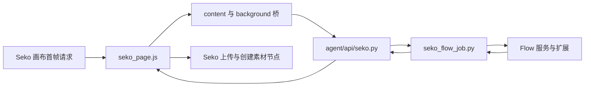

# 当前架构

- `agent/api/seko.py` 显式项目/参考映射、作业落盘、输入摘要去重、状态迁移和分块媒体读取。
- `scripts/seko_flow_job.py` 提交/收集，`agent/services/prompt_adaptation.py` 转换，SDK 层负责实际提供方请求。
- `extension/seko_page.js` 页面启动接管、读取既有作业、上传/检查/创建画布节点。当前依赖构建哈希模块与混淆导出名。
- 原生编辑器、Agent/Skill 与画布生成是不同路径；当前桥没有证明覆盖前两者。
- 自动回填画布不等于既有时间线引用自动更新；需要单独验证编辑器引用和导出。
