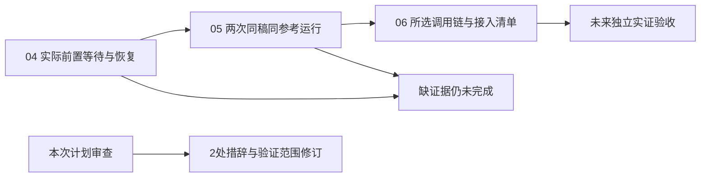

# Phase 1 gap plans — independent pre-execution check

## ISSUES FOUND

**范围：** 01-04/05/06，3份计划、7卡；规划检查，不是执行验收。**结果：0 BLOCKER，2 WARNING，1 INFO。** 另保留旧验收中的7项 descriptor-less 禁止项警告与4项未分类假设，不将它们重新包装成新增整改或已解决。



## Coverage and dependencies

| Requirement | Planned implementation | Verdict |
|---|---|---|
| BASE-01 | 旧01-01矩阵；04保留来源引用；06-02复核三家与历史反例 | Covered |
| BASE-02 | 04真实控制；05双运行比较；06-01逐步实际输入输出/触发/状态 | Covered |
| BASE-03 | 04当次构建与协议绑定；旧桥状态独立保留 | Covered |
| BASE-04 | 06-02 required步骤逐项接入映射与四指标；技术阻断直接上报 | Covered |

D-01～14全部有执行动作覆盖；D-09～11明确只交接后续质量/调度责任。D-05/06要求完整流程优先、人工确认/编辑/搬运均计入；D-07/08保持输入和风格开放。未发现以静态介绍、旧产物、后置取消或只填ready代替目标的范围削减。

| Plan | Tasks | Files | Wave / dependency | Estimate / budget |
|---|---:|---:|---|---|
| 01-04 | 2 | 5 | 4 / 01-03 | 30,000 / 100,000 |
| 01-05 | 3 | 4 | 5 / 01-04 | 34,000 / 100,000 |
| 01-06 | 2 | 5 | 6 / 01-05 | 28,000 / 100,000 |

三个estimate-check均使用--calibrated；都未超预算，confidence=low、sample_count=0，不能视为已校准精确预测。旧01→02→03和新增04→05→06依赖无环；共享检查器与JSON均有先后顺序，无同wave共享写入竞态。

## Verification findings

```yaml
issues:
  - plan: "01-GAP-PLAN-INDEX"
    dimension: context_compliance
    severity: warning
    required_property: "授权来源必须区分历史付费实测许可与当前仅规划请求。"
    description: "排除项段写‘用户最新明确单次必要取证授权覆盖’，但当前请求是只规划；PROJECT记录的是既有生成消耗授权。索引首行虽声明未执行，这句话仍错误归因最新指令。"
    fix_hint: "可表述为历史授权沿用于未来执行，当前只生成和审查计划；执行仍受04前置证明及单次预算约束。无需重复索取已有授权。"
  - plan: "01-06"
    dimension: verification_derivation
    severity: warning
    required_property: "计划末补丁检查须实际覆盖本计划改动，而非在逐卡提交后检查空工作区。"
    description: "两卡action要求验收后精确提交，计划末唯一automated却是裸git diff --check；逐卡提交完成后该命令可以对空差异返回0。verify.plan-structure亦返回R6警告。"
    fix_hint: "可明确此检查在每卡提交前执行，或让最终检查引用真实记录的计划起止提交范围；选择任一能覆盖实际改动的方法即可。"
  - plan: null
    dimension: verification_derivation
    severity: info
    required_property: "未经执行验证的禁止项和假设必须继续显式标记未验证。"
    description: "旧VERIFICATION的7项唯一禁止项在新增计划中保留unresolved/verification:null（其中一项重复出现）；GAP-VALIDATION保留4条unclassified假设。它们尚无可独立执行描述符，旧警告不能因计划检查而销项。"
    fix_hint: "保留当前未决状态和旧警告，不发明描述符、不以规划通过或合成测试自动销项。此项无新增修订要求。"
```

## Checks performed and limits

- 结构工具：04/05/06均valid=true；04支持tracer任务，全部7卡有files/action/verify/done；06的R6警告如上。未将工具支持的tracer误判为无效类型。
- 原样消费两个/tmp探针：39条命令，verify-paths=not_applicable且无severity问题；failure-directions=ok且无severity问题。未重跑或手工替代探针；not_applicable不等于所有命令路径已经实测可运行。
- Nyquist：7/7卡有自动检查和失败方向；GAP-VALIDATION存在；Wave4/5/6为2/2、3/3、2/2；新增gate/comparison/flag均明确由先行creates卡实现再调用。没有运行尚未实现的命令。既有107 Python/16 Node仅为历史基线，本次未运行这些suite。
- 关键连接：protocol_trials→当前build→execution_channel→候选run→selected required steps→integration_items已写入动作与反例；输入UTF-8 hash、reference UUID/hash、实际运行身份及观察窗口均绑定。未知提交只查既有身份，不重发。
- 架构责任：控制证据要求真正派发执行层；浏览器静默、截断窗口、后置取消均不能证明服务端控制。新final通道必须具有全部真实前置/接受/恢复证据；isolated_observation仅可观察不得授予可行性。
- 静态源核对：agent/models.json和flow_batch.py确有NANO_BANANA_2_1→BELUGA、abra_i2v_8s；现有validate_final确以bridge.status=ready判断可行。计划区分配置事实与未来实际请求/输出，不将本次静态核对算成实测。
- AGENTS/PATTERNS：沿用标准库unittest/Node、已有检查器与测试类；batch而非临时循环脚本、无安装、UUID引用、来源脱敏；不新增生产桥/持久调度。研究责任表与本轮任务层次一致。RESEARCH采用Execution Evidence Gaps列未来取证，没有Open Questions未决设计段；未知运行能力仍是计划要调查的目标。
- T-01-12～20连续唯一，T-01-SC为既有共用威胁标识；未误计为新增重复威胁。
- 取证有界不保证一定发现可用协议；这不是计划前必须已有实证的要求。计划已规定真实门未成立不完成任务，并由INDEX/VALIDATION明确技术阻断直接上报，不等待05盲跑，因此未把外部未知本身列为阻断规划的问题。

## Recommendation

修订上述2处WARNING后可重新检查计划。该结论不授予当前生成许可，不证明Phase1完成，也不解除Phase2依赖。真实控制、双候选运行与独立验收仍全部待执行。此报告只写审查文件，无源代码/计划改动、安装、联网、生成或提交。


---

## Revision 1 closure — 2026-10-15

### VERIFICATION PASSED

**本轮范围：仅复核初审两项 WARNING。两项均关闭；当前修订项为 0 BLOCKER / 0 WARNING。** 上方初审记录原样保留，不把历史 ISSUES FOUND 当作当前修订结论。原有 INFO 是未验证状态提示，继续有效，不新增发现、不自动销项。本节不是对整个阶段执行结果的通过声明。


| 初审 required_property | 当前可核对证据 | 本轮结论 |
|---|---|---|
| 授权来源必须区分历史付费实测许可与当前仅规划请求 | INDEX 排除项明确 PROJECT 的历史付费生成授权沿用于未来执行；最新请求仅授权规划与计划审查，不执行取证；未来执行仍受 01-04 前置证明及单次预算约束 | CLOSED |
| 计划末补丁检查须实际覆盖本计划改动，而非在逐卡提交后检查空工作区 | 06 的“逐卡提交前补丁门”规定先测试/来源验收、仅暂存本卡声明修改，再检查和提交；两卡 verify 均对各自声明路径执行 `git diff --cached --check`，随后读取同路径暂存清单并以 `test -n` 拒绝空差异；fails_when 明确不得在提交后用空暂存区通过 | CLOSED |

06 已移除计划末裸 `git diff --check`；最终门改为核对 SUMMARY 中每卡检查命令、结果、暂存文件清单及对应提交 SHA，任一卡缺记录即不验收。因此检查对象、运行时点、非空条件与提交证据已连接，满足原警告的不变量。这里只验证计划写明的流程，没有运行这些实现测试、暂存或提交命令。

本轮原样消费 `/tmp/flow-gap-verify-paths-r1.json` 与 `/tmp/flow-gap-failure-directions-r1.json`：两者各 40 条，均 0 blocker / 0 warning、readError=null；前者 status=not_applicable，后者 status=ok。未重跑或手工替代探针；not_applicable 不表示所有路径已实测可运行。

七项 descriptor-less 禁止项与四项 unclassified 假设仍保留未验证/未决状态。没有把它们转为新增修订要求，也没有因两项警告关闭而宣称已验证。初审其他维度不重开；未运行应用、实现测试、联网、安装或提交，仅追加本报告。

**当前结论：两项修订已满足原 required_property；本轮无需再修订。计划尚未执行，Phase1 尚未通过，不解除 Phase2 依赖。**
