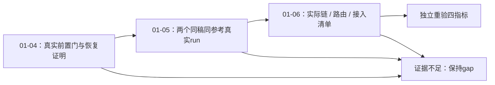

# Phase 1 缺口验证策略

本文件只描述01-04～06的待执行验证，不更改旧01-VALIDATION/VERIFICATION的结果或指纹。7卡未执行；旧107 Python + 16 Node是基线记录，不是本次已运行。所有命令cwd为仓库根；不安装pytest/fastapi或其他依赖。

## 验证命令与创建顺序

既有可运行命令：

- `python3 -m unittest tests.test_workflow_evidence_probe tests.test_seko_probe tests.test_seko_flow_job tests.test_platform_probe -v`
- `node --test tests/test_seko_generation_hook.cjs tests/test_seko_resident_page.cjs tests/test_seko_native_backfill.cjs`
- `python3 scripts/workflow_evidence_probe.py --evidence docs/benchmarks/workflow-boundaries/evidence.json --build docs/benchmarks/workflow-boundaries/current-build.json --stage final`（旧审计只读基线；到期不改日期，不能据此签本轮通过）

新命令共用前缀：
`python3 scripts/workflow_evidence_probe.py --evidence docs/benchmarks/workflow-boundaries/gap-evidence.json --build docs/benchmarks/workflow-boundaries/gap-current-build.json`。

01-04-01先创建两个新JSON、stage=gate、--require-gap-closure及反例，之后才使用上述前缀加 `--stage gate --require-gap-closure`。01-05-01先创建comparison阶段及反例，之后加 `--stage comparison --require-gap-closure`。01-06完善controls/final的强制缺口证明，使用 `--stage controls --require-gap-closure` / `--stage final --require-gap-closure`。不能提前声称新入口存在或已通过。

| 卡片 | 需求 | 自动检查 | 真正验收门 | 状态 |
|---|---|---|---|---|
| 01-04-01 | BASE-02/03/04 | unittest + gate | 至少一条当前真实执行层未派发→接受→恢复→下一门证据 | pending |
| 01-04-02 | BASE-02/03 | unittest + gate | 两候选所有图/视频路径受控；相同稿hash和非空参考集合 | pending |
| 01-05-01 | BASE-02 | unittest + comparison | 官方run的实际终点、输出、操作/耗时，完整窗口 | pending |
| 01-05-02 | BASE-02 | comparison | 创作者run同条件真实完成；不改稿或参考求成功 | pending |
| 01-05-03 | BASE-02/04 | unittest + comparison | 双完整流程比较、先完整度后人工成本的真实选择 | pending |
| 01-06-01 | BASE-02 | unittest + controls | 所选run逐步合同与九类路由；配置不等于请求/输出 | pending |
| 01-06-02 | BASE-01～04 | scoped Python/Node + final | required→清单全部闭合，四指标与证据一致；独立重验 | pending |

每卡所有automated后都有fails_when；非零/零测试拒绝，probe退出0不足以完成。每计划末运行两条既有suite。RED只留记录，GREEN与真实验收后提交。现有本地suite反馈在60秒内；外部运行时长单独实测，不能用测试时间代替候选耗时。

## 必保留与新增反例

CR-01 `test_candidate_comparison_requires_bound_current_run`；CR-02 `test_actual_404_samples_cannot_support_forged_matched_rows`；CR-03 `test_model_route_cross_type_mode_duration_and_alias_rejected`；CR-04 `test_final_unknown_trigger_blocks_both_complete_conclusions`、`test_final_trigger_requires_matching_execution_observation` 全部保留并运行。

新增反例：错audit/candidate/run/input/ref/build，过期样本，缺执行层未派发证明，后置取消、仅浏览器静默、截断窗口、缺外部接受或恢复身份、只声明通道ready、只控一个生成步骤、旧素材protocol_only冒充新生成、null人工数被记0、隐藏搬运动作、partial强选、workflow_coverage借另一run。合成正例只验证检查器，真实证据必须另外取得。

## 四指标与停止/恢复

| 状态 | contract_valid | report_complete | feasibility | ready_for_phase2 |
|---|---|---|---|---|
| 结构/哈希/声明冲突 | false | false | unassessed | false |
| 记录诚实但缺比较/控制/必需合同 | true | false | unassessed | false |
| 完整实际链及当前前置/恢复证据成立 | true | true | feasible | true（仅依赖许可，非自动执行） |
| 全链证据充分且关键路径技术不可接管 | true | true | blocked | false（带证据范围决定） |

局部技术blocked只支持该路径，不能使整条报告完整。04阶段未找到协议、登录/归档缺失、接口未知属于证据不足；停止相关派发并说明恢复所需具体证据，不发明成功或技术不可能。技术阻断直接上报上游，不能等待05盲跑。恢复需当前同构建协议/权限/引用已恢复并重验gate；未知提交先核对已登记身份，不重复收费。

旧桥3模块404不可改成ready。新取证通道必须是实际已有能力，完整前置控制及外部接受/恢复证明；只读观察通道不等于可接入。任何新生成仅为明确单次必要取证，按真实拆镜登记预算，通过既有batch，不做生产桥/常驻/质量/声音验收。

## 假设、禁止项和独立验收

4条edgeprobe输入保持：BASE-01/02/03/04分别category=unclassified、status=unresolved、verification=null。不自动分类、销项或发明check描述符。7条旧禁止项全部分布在04～06 frontmatter，status=unresolved、verification=null，descriptor-less警告继续保留。没有执行证据不能写已验证禁止项。

ASVS1、high阻断；T-01-12～20连续唯一，T-01-SC保留。人工检查脱敏、真实出处与范围，测试不能替代。旧审计/evidence/current-build、旧PLAN/SUMMARY、旧REVIEW/VALIDATION/VERIFICATION均不改。新增计划会改变验证覆盖，交独立验证器重验并生成新fingerprint；此文件不能自授Phase1完成。

任务/Phase1/M1/整体分别验收；本轮只有Phase1缺口计划。未执行标pending，失败标真实原因；每卡SUMMARY记录实际命令/退出码、时间、证据ID、验收方式/人、提交SHA，阶段整体验收另列。
