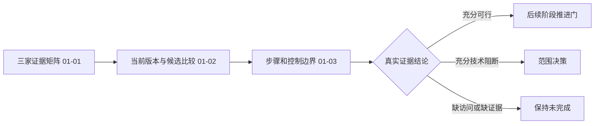

# Phase 01 — 执行前计划审查

## VERIFICATION PASSED

**Phase:** 成熟工作流与接管边界
**Plans checked:** 3；7 张任务卡
**Current issues:** 0 blocker，0 warning，0 info
**Revision:** 首轮 1 blocker；研究文档分类修正后定向复核通过。
**审查范围:** 静态计划与既有确定性探针；未执行产品、业务测试、安装、生成或提交。



## 覆盖与任务完整性

| 需求 | Frontmatter 计划 | 实际覆盖任务 | 结论 |
|---|---|---|---|
| BASE-01 | 01-01 | 01-01-01/02：真实来源 tracer、三平台×三入口、历史引用反例 | 覆盖 |
| BASE-02 | 01-02、01-03 | 01-02-02：官方/玩家同稿比较；01-03-01/02：步骤合同、真正执行层和前置控制 | 覆盖 |
| BASE-03 | 01-02 | 01-02-01：当前构建、三项旧模块依赖、导出、桥状态与时效 | 覆盖 |
| BASE-04 | 01-03 | 01-03-02/03：有据阻断、接入清单、范围决策与推进门 | 覆盖 |

PROJECT 中直接属于本阶段的入口/范围/缺口调查和逐卡测试验收提交均有任务；生产接入、恢复、声音和整集未被错误计入本阶段。D-01～D-14 均有落实内容，D-09/10 的完整规则作为后续交接，未提前实现调度。未发现静默缩减、统一工作台或全 API 实现扩张。

| 计划 | 任务 | 文件 | Wave / 依赖 | 结构检查 | 估算 / 预算 |
|---|---:|---:|---|---|---|
| 01-01 | 2 | 4 | 1 / 无 | valid=true，0 errors/warnings | 28,000 / 100,000 |
| 01-02 | 2 | 6 | 2 / 01-01 | valid=true，0 errors/warnings | 30,000 / 100,000 |
| 01-03 | 3 | 5 | 3 / 01-02 | valid=true，0 errors/warnings | 34,000 / 100,000 |

估算均经 `estimate-check --calibrated`：over_budget=false，confidence=low，sample_count=0。尚无项目实际消耗校准，不能将其视为精确预测；任务/文件数量也未超阈值。

三份计划的 must_haves 已提取并核对原文。每卡均有 read_first、files、behavior、action、acceptance_criteria、verify、done。结构工具接受首卡 tracer 类型。共享脚本、测试和 evidence.json 由明确串行依赖保护；没有同 Wave 计划对、循环或未声明跨计划先决产物。

## 验证与关键链接

| 任务 | Wave | 自动检查 | 失败方向 | 状态 |
|---|---:|---|---|---|
| 01-01-01 | 1 | unittest + probe tracer | 非零/FAILED/ERROR/零测试；空 evidence/checks 或合同无效 | 通过 |
| 01-01-02 | 1 | unittest + probe matrix | 上述测试信号；三平台×三入口缺项 | 通过 |
| 01-02-01 | 2 | unittest + probe build | 上述测试信号；modules 为空/陈旧当前声明 | 通过 |
| 01-02-02 | 2 | unittest + probe candidates | 上述测试信号；selected 却比较未完成 | 通过 |
| 01-03-01 | 3 | unittest + probe steps | 上述测试信号；空选中步骤或悬空依赖 | 通过 |
| 01-03-02 | 3 | unittest + probe controls | 上述测试信号；proven 缺当次前置证据 | 通过 |
| 01-03-03 | 3 | unittest + probe final | 上述测试信号；缺映射或可行性/完整性/推进许可矛盾 | 通过 |

Nyquist：VALIDATION 存在；Wave 1=2/2、Wave 2=2/2、Wave 3=3/3；首卡创建测试与 CLI，后续卡先扩展 stage 再执行；无 watch/E2E 或显式长等待。预期反馈小于 60 秒，尚未执行测量。失败方向使用 `/tmp/flow-phase1-verify-directions.json`，20/20 ok，0 blocker/warning。

路径探针使用 `/tmp/flow-phase1-verify-paths.json`：20 条均 not_applicable、severity=none、无 readError。该探针不识别此处 Python/Node 形式，**不表示路径已被确定性验证**。未重跑或自行改判探针；另按普通创建依赖检查，新增 CLI、测试和 evidence 在 01-01-01 创建，build 在 01-02-01 创建，各 stage 有顺序实现任务。

关键链接已落到动作：报告 claim_id→evidence、candidate→steps→integration_items、current-build→当次控制证据。final 重跑已有适用检查；contract_valid 不自动产生 feasible/report_complete/ready_for_phase2。缺社区来源、登录或归档只能保留 unassessed/未完成；充分技术阻断可验收边界报告但不可推进 Phase 2。来源哈希与单测均明确不替代人工真实性复核。

## 其他维度

| 维度 | 结论 |
|---|---|
| Architectural Responsibility Map | 符合：真正派发层控制与浏览器事件分离；本地仅审计；厂家保留服务明确 |
| Cross-plan data contracts | 兼容：同一标准库合同逐阶段扩展，保留历史/当前和原始来源范围，未发现互相破坏的转换 |
| AGENTS / 用户约束 | 零安装、禁止假完成/换模型；在线采样先健康与现场核对；任务测试验收提交有门槛 |
| Pattern compliance | 现有 probe、测试与三家报告作为 analog；无 analog 的证据格式按研究/计划明确合同；允许内联 fixture |
| Numeric/factual authority | 历史 33/16 明示为研究结果；未作为必须匹配的硬编码计数；无测量冲突 |
| Verify format | 无吞错默认值、永真命令或树状输出锚点问题 |
| AI/UI/API 实现 gate | 不适用：本阶段是调查与审计交付；内联表格/流程图不构成新 UI 实现 |
| Review incorporation | 标准模式，无 REVIEWS 输入 |

## 首轮发现与修正历史（已关闭）

**Research resolution — 研究层未决规划与执行取证缺口必须明确区分。**

首轮审查时，`01-RESEARCH.md:277–282` 在 `## Open Questions` 下列玩家候选、服务端前置控制、当前构建和厂家口型边界四项，均无 resolution。按 plan-checker Dimension 11，该形态当时阻止通过研究解决门。

这些问题实际上已被任务 01-02-02、01-03-02、01-02-01、01-03-01/02 接管，有明确可行/技术阻断/证据不足门槛；它们是本阶段执行要采集的事实，不能为消除 gate 将未观察事实标为已解决。可修复的是研究文档分类与规划处置：明确研究层没有遗留待决定方案，并保留每个执行缺口的任务、证据与状态规则。

```yaml
historical_issues:
  - plan: null
    dimension: research_resolution
    severity: blocker
    status: resolved
    required_property: "RESEARCH 不得保留未处置的规划 Open Questions；执行取证缺口必须与研究层规划决策明确区分。"
    description: "01-RESEARCH.md:277–282 的 ## Open Questions 列出玩家候选、服务端前置控制、当前构建、厂家口型边界四项，无 RESOLVED 或规划处置；虽然 PLAN 已安排取证和结论门，研究文档尚未完成这种区分，触发 Dimension 11。"
    file: "01-RESEARCH.md"
    fix_hint: "例如将四项归入 Execution Evidence Gaps，逐项关联现有任务与通过/阻断/未完成规则，明确规划决策已定而线上事实仍待执行证实；不要把未知事实改成 RESOLVED。"
```

## 定向复核结果

已读取修正后的 `01-RESEARCH.md:277` 起段落：标题变为 `Execution Evidence Gaps — 执行取证缺口`，四项分别关联 01-02-02、01-03-01/02、01-02-01、01-03-01/03，并明确比较完成、派发前控制、当前构建及最终媒体来源的证据门槛。文档明确规划处置已定，线上事实仍 pending；证据不足不代表技术不可能，充分技术阻断也不允许按可接入推进 Phase 2。

该修正满足首轮 required_property，未将未知事实伪装为已解决。PLAN 无变动，本轮仅定向复核这一项；首轮其他维度结论保留，未重复业务测试或安装。

```yaml
issues: []
status: passed
resolved_findings: 1
```

**结论：** 三份计划的执行前审查通过，可进入 `$gsd-execute-phase 1`。此结论只表示计划满足审查要求，不代表产品执行、线上接管或阶段验收已通过。
