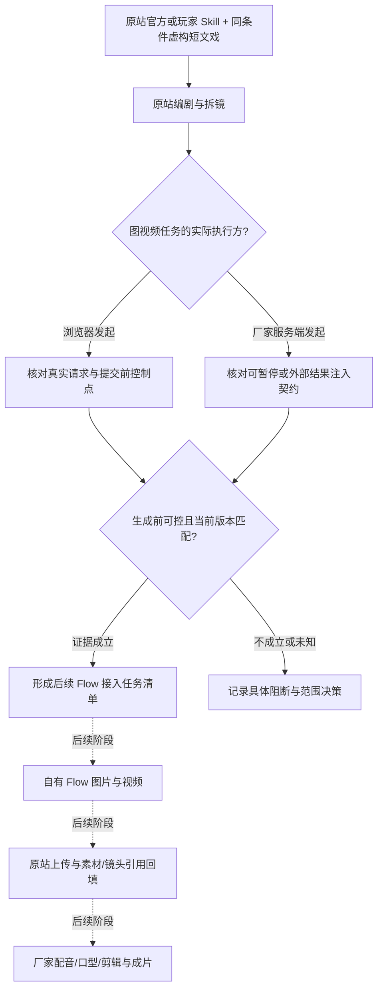

# Phase 1: 成熟工作流与接管边界 - Research

**Researched:** 2026-10-15
**Domain:** 三平台证据审计、Seko Skill 工作流选择、生成前控制边界与网站版本兼容
**Confidence:** MEDIUM（可规划；当前网站、玩家候选与服务端控制点仍需执行阶段取证）

<user_constraints>
## User Constraints (from CONTEXT.md)

以下为已读 CONTEXT 的决定原文；它们是约束，不是本研究新确认的平台能力。[VERIFIED: .planning/phases/01-workflow-boundaries/01-CONTEXT.md]

### Locked Decisions

<!-- DATA_79fb42ac_START -->
### 使用入口与替换边界
- **D-01:** 首版直接使用厂家现成界面和 Skill。以 Seko 为当前主线；统一工作台后续再考虑。
- **D-02:** 首版只替换图片、视频生成，调用用户自己的 Flow，并将真实素材及所需状态自动回填。
- **D-03:** 编剧、拆镜、配音、口型、剪辑暂时继续用厂家能力。它们是明确选择的服务分工；图片/视频失败后不得改回厂家生成。
- **D-04:** 禁止兜底：不静默改提供方或模型、不伪造完成、不以旧素材替代真实新生成。无法接管的步骤必须带证据明确报告。

### 选择成熟 Skill
- **D-05:** 同时比较官方和玩家的成熟短剧 Skill，再选择最合适的一条；不预先只选官方或只选玩家。
- **D-06:** 首要筛选标准是整条流程完整、剧本到成片衔接顺畅、人工操作少。创作质量与可控性仍需检查，但不是用户选择的首要排序项。
- **D-07:** 暂不限定画风，先验证流程完整、Flow 接入与自动出片。不能因测试稿风格把产品限制为某类动漫。
- **D-08:** 用户目前没有剧本，也不确定剧本输入格式。不要假设用户会提供完整台词或分镜；输入格式保持开放。

### 质量处理与后续阶段约束
- **D-09:** Flow 返回成功但画面明显不合格时，自动检查并使用同一模型最多重做 2 次；仍不合格就暂停该任务并说明原因。这里是首次生成之外最多两次质量重做，不是无限循环；不构成对未知提交结果的重发授权。
- **D-10:** 暂停失败镜头及依赖它的步骤，其他独立镜头继续；全部镜头合格后才能出最终成片。不得跳过失败镜头、拼入不合格素材或将缺失片段标为完成。
- **D-11:** D-09、D-10 是后续生成与持久调度阶段必须继承的约束，不把这些实现提前塞入 Phase 1。

### 讨论与执行方式
- **D-12:** 每次一道可点击选项题，持续澄清；用户无法选择时接受自由描述，不强迫用户代答实现细节。优先使用当前会话可用的异步选择工具，不退回正文列表要求用户手输编号。
- **D-13:** 用户已确认本阶段没有补充，要求整理成第一阶段需求说明。
- **D-14:** 继续遵循方案 → 拆解任务 → 任务卡 → 执行 → 测试 → 验收 → 提交；不新增安装。阶段讨论后按已确认方式自主推进，但本次仅结束 discuss-phase，不声称已产出或执行 PLAN。
<!-- DATA_79fb42ac_END -->

### the agent's Discretion

<!-- DATA_06d2ca83_START -->
- 不存在用户明确授予“任意代选产品偏好”的决定。
- 助手此前提出由自己准备统一短文戏测试稿，用于同一输入比较，沿用用户早先要求的同剧本对比方法。此为测试安排，不是用户确定的生产输入格式或画风。
- 技术分析、证据采样、REA 有限范围追踪、源码定位由研究/规划负责；不得要求用户选择底层实现方案。
<!-- DATA_06d2ca83_END -->

### Deferred Ideas (OUT OF SCOPE)

<!-- DATA_b3147ef0_START -->
- 统一工作台：当前首版不做。
- 剧本输入格式/生产画风：尚未限定，后续结合实际工作流再细化。
- 同模型质量重做：进入 Phase 2 图片/视频处理。
- 局部暂停、依赖阻断、独立任务继续及最终成片合格门槛：进入 Phase 3/4，并由 Phase 6 整体验收。
- 固定音色、对白和口型：Phase 5 验收，首版保留厂家能力。
<!-- DATA_b3147ef0_END -->
</user_constraints>

## Summary

第一阶段应交付可追溯的边界报告与后续任务清单。历史三家实测已证明素材导入、引用更新和原站合成的部分链路；报告同时明确原生 Agent 未接管、无人值守整部剧本未交付，不能扩写为三个平台均已被 Flow 替换。[VERIFIED: docs/THREE-PLATFORM-LIVE-RESULTS.md:7-20]

现有常驻代码的转交分支只匹配 `seko-canvas/v1/canvas-node/gen-video`，且依赖写死的站点构建模块；启动前的视频请求拦截范围比这个分支更广。拦住请求、转交 Flow、回填画布、更新既有时间线、驱动 Skill 继续，是不同能力。当前研究可以确认本地代码和归档证据，不能确认今天的站点版本与 Agent 服务端生成前控制点。[VERIFIED: extension/seko_page.js:26-32,106-117; scripts/seko_probe.py:22-48]

**Primary recommendation:** 顺序安排“证据与三家矩阵 → 当前版本及官方/玩家候选核验 → 选中流程逐步契约、前置控制证明及可行性结论”。通过门槛是每条关键结论可回到证据；遇到不可证实的服务端前置控制点，输出具体阻断及范围决策入口，不提前实现后续阶段。[VERIFIED: .planning/ROADMAP.md Phase 1; .planning/phases/01-workflow-boundaries/01-CONTEXT.md Phase Boundary]

## Architectural Responsibility Map

下表为规划责任分配；现状依据页面桥、服务端校验和用户服务分工，不代表这些能力全部完成。[VERIFIED: extension/seko_page.js:36-91; agent/api/seko.py:20-26,52-66; .planning/phases/01-workflow-boundaries/01-CONTEXT.md D-01–D-04]

| 能力 | Primary Tier | Secondary Tier | 规划责任 |
|---|---|---|---|
| Skill 选择、输入与阶段确认 | 原站 Browser / Client | 厂家 API / Backend | 保留原站入口；记录人工确认次数及传入内容 |
| 编剧、拆镜、配音、口型、剪辑 | 厂家 API / Backend | 原站 Browser / Client | 保留用户明确选定的厂家服务；单列实际媒体重生成行为 |
| 图视频生成前控制 | 真正发起厂家生成的执行层 | 浏览器桥 / 本机 API | 先证明执行层与拦截时机；浏览器不能因看到事件流就被认定控制服务端 |
| 显式映射、请求审计与去重 | 本机 API / Backend | 本地 Storage | 第一阶段只核对既有契约及缺口，不扩建调度器 |
| 上传、素材节点与时间线引用 | 原站 API / Backend | 原站 Browser / Client | 区分节点创建成功和旧镜头引用更新 |
| 证据索引、矩阵与兼容快照 | 本地审计文档 | 本地归档文件 | 脱敏后入 Git；私有原始证据留本机 |

<phase_requirements>
## Phase Requirements

需求描述原文来自 REQUIREMENTS；研究支持是本阶段建议任务分解。[VERIFIED: .planning/REQUIREMENTS.md 成熟工作流与接管边界]

| ID | Description | Research Support |
|---|---|---|
| BASE-01 | 用户能查看三家已验证能力与未完成项，并区分按钮、编辑器、Agent/Skill 的接管范围。 | 三家历史证据矩阵、出处时间与范围、实际素材/引用审计 |
| BASE-02 | 用户能针对选中的 Seko 成熟工作流，查看每一步输入输出、实际执行方及生成前可控边界的证据。 | 官方/玩家同口径比较；逐步骤契约；生成前控制证据规则 |
| BASE-03 | 用户能知道当前网站版本和接入是否匹配；过期模块或无法接管的路径必须明确标记。 | 当前页面资源、网络可用性、模块导出和桥启动状态的独立核验 |
| BASE-04 | 用户能得到目标工作流的接入清单和真实可行性结论；不能完成的步骤有具体阻断证据。 | 接入清单、前置条件、后续阶段归属、阻断证据与范围决策 |
</phase_requirements>

## Project Constraints (from AGENTS.md)

以下是项目文件的可执行要求提取，执行时服从本次用户锁定范围；其声音、重做等通用规则不扩大 Phase 1。[VERIFIED: AGENTS.md:6-34,36-54,80]

- 每个工作流开始检查服务健康；Flow 模式须检查扩展连接。健康响应不替代 Seko 当前页面和桥鉴权核验。
- 媒体标识使用 UUID；若收到非 UUID 编码，按原响应 URL 提取 UUID，不将编码串当媒体标识。
- 场景提示词仅描述动作，外貌由参考图承担；参考实体媒体齐备后才能生成场景；地点横图、角色竖图。
- 禁止临时脚本循环 API 请求；生成通过已有批量接口，由服务按提供方限流，不手工错峰。
- 区分生成和重新生成；图片重做须清理下游视频及放大结果。项目须指定材质。
- 视频提示词包含分段时序；对白写入分段且遵守长度约束。场景内容通过更新操作修改，避免删建。
- 真实事件创作先查证；意见明确标识。项目还有真实人物名称/别名和外观描述约束；第一阶段统一测试稿使用原创虚构人物即可，无需新增真人处理方案。
- 视频放大前执行质量复核；仓库规则规定阈值和最多两次复核重做，但本阶段不实现或调用质量循环，后续严格继承 D-09、D-10。
- 顺序为研究、健康检查、工程/场景、参考图、场景图、视频、复核、可选放大/配音、合成；调用具体项目 Skill 时先读相应说明。
- 本次用户额外明确：方案 → 拆解任务 → 任务卡 → 执行 → 测试 → 验收 → 提交；里程碑及整体同样验收提交；禁止兜底、不新增安装、中文内联可视化。[VERIFIED: 用户本轮 AGENTS.md 指令; 01-CONTEXT.md D-04,D-14]

## Standard Stack

本阶段不安装、更新或新增外部包，也不把历史工具版本当作最新版本。采用已运行成功的本地标准库与 Node 内置测试工具；不需要 npm/PyPI 最新版本查询或安装命令。[VERIFIED: 01-CONTEXT.md D-14; 本次 2026-10-15 环境探测与离线测试输出]

| 工具 | 本次版本 / 可用性 | 用途 | 使用决定 |
|---|---|---|---|
| Python 标准库 JSON、hashlib、unittest | Python 3.13.7；离线 33 项通过 | 证据格式、哈希、既有引用审计 | 直接复用，不新增解析依赖 |
| Node 内置 test、assert | v24.15.0；离线 16 项通过 | 页面桥与回填边界回归 | 保留现有测试；模拟不冒充线上验收 |
| 现有浏览器 / Chrome MV3 扩展 | 源码版本原文 `"version": "0.5.2"` | 执行阶段只读检查当前页面、模块与入口 | 不更新扩展、不因研究刷新破坏旧现场 |
| 既有本机服务 | 健康响应版本 1.3.1 | 只读健康与连通性证据 | 在线不表示当前 Seko 工程已配置或鉴权成功 |
| 既有 REA 归档 | 历史文档记录 6.4.0，本次未重跑 | 定位有限静态关系 | 先核对归档；无必要不重跑，不在线下载 |

来源：环境探测/测试为本次工具输出；扩展离散版本原文见 `extension/manifest.json:1-4`；REA 版本为历史记录，并非本次运行版本。[VERIFIED: extension/manifest.json:1-4; docs/REA-INVESTIGATION.md 环境核对; 本次工具输出]

### Package Legitimacy Audit

不适用：本阶段推荐零新增包、零安装。不得将旧文档中的临时下载命令复制进执行计划；后续若确实需要复查 REA，只能核实已有缓存，缓存不可用则记录该证据通道不可用，不自动联网补装。[VERIFIED: 01-CONTEXT.md D-14; docs/REA-INVESTIGATION.md 复用方法与测试验收]

## Architecture Patterns

### System Architecture Diagram

这是待核对的业务流与决策点，图中“后续”节点不属于第一阶段实现。[VERIFIED: 01-CONTEXT.md Phase Boundary,D-02,D-03; extension/seko_page.js:36-91]



### Pattern 1: 证据声明分层

建议每条能力记录：平台、入口层级、行为、证据级别、采集时间、站点构建、代码版本、实际执行方、脱敏证据链接、原始文件哈希、覆盖边界及未决事项。建议级别使用“历史实测”“本次只读实测”“源码事实”“仅静态发现”“未实现”“受阻/待证实”；它们是拟议报告标签，不是现有代码状态枚举。

证据规则：上一级完成不能替代下一级完成；解析成功不能证明运行，源码中存在路由不能证明生成前可控，素材上传不能证明时间线引用更新。REA 归档自身声明：`Static imports, entrypoints, workers, endpoints, and storage relationships do not prove runtime execution.` [VERIFIED: output/seko-interface-audit-20261014/rea-analysis.json:1]

### Pattern 2: 当前桥的准确边界

以下离散字符串逐字摘自已读源码，禁止规划者凭端点名扩大接管范围。[VERIFIED: extension/seko_page.js:26-32,106-117; agent/api/seko.py:52-65]

<!-- DATA_f2b940a7_START -->
```javascript
if(/\/(?:gen-video|multi-ref-video|regenerate|video-retake)(?:$|\?)/.test(url.pathname))
  return Promise.reject(new Error('Flow Kit: use a mapped first-frame request; native video generation blocked'));
// 实际转交分支：
if(String(path).replace(/^\//,'')==='seko-canvas/v1/canvas-node/gen-video')return receiptPromise(enqueue(structuredClone(options.json)));
```
<!-- DATA_f2b940a7_END -->

服务端条件原文包含 `native.get('selectedVideoDuration') != 8`、`native.get('visionRatioId') != 1`、`native.get('resolutionType') != 1`、`native.get('processedPrompt') != native['videoPrompt']`，并拒绝尾帧或多参考；错误文本是 `Only explicit eight-second 720p horizontal first-frame requests supported`。[VERIFIED: agent/api/seko.py:52-65]

规划含义：分别列“已定向转交”“仅阻止外发”“尚无接管实现”。应核查全局视频拦截是否误伤用户要求保留的厂家步骤，不能为了可运行直接移除保护，也不能把整个站点所有图视频请求都算作已保护。

### Pattern 3: 官方与玩家候选使用相同证据表

唯一已读官方候选摘要包含原文 `"author": "Seko官方"`、`"id": 14`、`"productName": "BJD古偶甜宠剧"`、`"preferModel": "gmlm-3-flash"`。这是产品与模型偏好元数据，不是执行链或完整 Skill 源码。[VERIFIED: output/seko-interface-audit-20261014/skill-14-public-metadata.json:2-4,31-33]

其说明原文为：`输出内容:故事大纲、分集规划、单集剧本、分镜表、生图与生视频提示词及视频素材`；说明提及逐步确认，因此“流程完整、人工少”必须分别核对，不能凭宣传描述认定一键自动成片。[VERIFIED: output/seko-interface-audit-20261014/skill-14-public-metadata.json:3]

已读社区模块静态定义包含 `ee.get(te("/v1/skills")`、`ee.get(te(\`/v1/skills/${xe(e)}\`))`，也包含 `ee.put(te(\`/v1/skills/${xe(e)}/use\`),{json:{canvasId:s}})`。详情查询与“使用”写入不是同一操作，执行阶段只读比较不能误点后者。[VERIFIED: output/seko-interface-audit-20261014/additional/skill-community-D_W5cFu8.js:1]

建议至少各核对一条真实官方候选和真实玩家候选，记录作者/来源证据、当前可访问性、支持输入、阶段输出、人工确认/编辑/搬运次数、图视频实际调用入口、原站合成衔接、前置控制风险。优先完整流程和少人工；可控性与当前版本匹配作为可执行门槛。若玩家目录不可访问，记录具体响应/登录/入口证据；不能虚构候选、不能擅自改成仅选官方。

### Pattern 4: 选定流程逐步骤契约

建议每个步骤单列输入来源及原字段、输出实体及引用、触发请求/事件、实际执行方、观察到的状态、失败语义、人工动作、生成前控制点、证据等级、当前版本、下一步依赖。字段未观察到就明确未知，不从相似路由推测。

编辑器静态源码原文同时存在 `D=async(t,e)=>await o.post(a(\`/${t}/gen-video\`),{json:e}).json()`、`A=(t,e)=>o.post(a(\`/${t}/gen-image\`),{json:e}).json()`，前缀函数是 `a=(t="")=>\`guodong-studio/v1/shots${t}\``。这些独立路径不等于画布接口。[VERIFIED: output/seko-interface-audit-20261014/rea-input/shot-BflClSjB.js:1]

Agent 前端还出现原文 `api:"/v1/agents/drama-script/plan"` 与 `api:"/v1/agents/drama-script/next-ep"`。这仅证明前端构造请求；真实服务器内部如何生成、是否可挂起并接受外部产物，需要独立取证。[VERIFIED: output/seko-interface-audit-20261014/rea-input/chat-QFpWq-zc.js:13]

生成前控制证明应包含：在厂家图视频任务派发之前可确定拦截/暂停的事件或调用；相应请求尚未发出且未产生厂家任务的可核对记录；独立的输入/输出/恢复契约。若唯一可见事件发生于厂家任务创建之后，只能说明观测结果，不能据此认定前置替换可行。第一阶段可接受充分证据支撑的阻断结论；不为“证明可行”临时实现生产桥或提交付费任务。

### Pattern 5: 当前版本分离于历史缓存

写死导入原文是 `'/assets/LoginContext-CFHyujin.js'`、`'/assets/canvas-BZat8bJg.js'`、`'/assets/useOSSUploader-BaPQIV7u.js'`。[VERIFIED: extension/seko_page.js:111]

PROJECT 的历史审计记录说明 canvas/uploader 地址在当次 GET 返回 404、LoginContext 返回 200；本研究没有重做当前网站请求，**本日兼容性未知**，不能把历史 404 宣称为今天仍 404，也不能把旧标签可运行当作今天新加载可运行。[VERIFIED: .planning/PROJECT.md 2026-10-14 核查证据]

执行阶段建议记录旧标签已加载源码、新的只读站点资源清单、服务器返回状态和内容类型、源码 SHA-256、实际导出、现有桥所需导出、登录/项目上下文、采集时间。地址返回成功也需核对内容不是 HTML 占位页；单个模块可下载不等于桥能够启动。先保存旧现场，不在有未知写入任务的标签上直接刷新。

### Component Responsibilities / 建议任务分解

| 顺序 | 有界交付物 | 验收点 | 不应混入 |
|---|---|---|---|
| 1 | 三家矩阵与脱敏证据索引 | 每格链接真实证据，历史/当前分栏，已存在的反例仍保留 | 平台接管实现、生成质量排名 |
| 2 | 当前构建兼容快照、官方/玩家候选比较与选择记录 | 真实候选、完整流程与人工步骤比较；版本未知与失配显式化 | 下载新工具、付费试片、原站写入 |
| 3 | 选中工作流的逐步契约、前置控制结论与后续接入清单 | BASE-02/04 每个关键步骤有证据或具体阻断；任务卡明确依赖与后续阶段 | 图视频适配器、调度恢复、质量重做或整集流水线 |

建议每张任务卡包含证据输入、输出、验证命令、人工运行证据、通过/阻断标准；结束时分别留下测试、验收、提交记录。这是对 D-14 的执行结构建议，不是新产品决定。[VERIFIED: 01-CONTEXT.md D-14]

## Don't Hand-Roll

| 问题 | 不要新建 | 使用现有资产 / 方法 | 依据 |
|---|---|---|---|
| 全站反编译 | 新引擎、全量重建器 | 已归档模块和 REA 有限结果，必要时定向核对源码 | REA 明确不证明运行且存在预算限制。[VERIFIED: docs/REA-INVESTIGATION.md; rea-analysis.json:1] |
| 平台引用替换核验 | 仅凭新 URL 的“成功”判断 | 已有平台快照审计与反例 | 旧引用、镜头遗漏、时序变化已有回归检查。[VERIFIED: tests/test_seko_probe.py:20-47; tests/test_platform_probe.py:29-67] |
| 生成前证明 | 可运行的模拟 Skill 冒充厂家 Skill | 实际当前入口、请求来源与服务端契约证据 | 静态接口不证明生成前控制。[VERIFIED: 01-CONTEXT.md Phase Boundary] |
| 工作流界面 | 新统一工作台 | 中文矩阵、流程图、证据链接 | 用户要求继续使用原站，统一界面已延期。[VERIFIED: 01-CONTEXT.md D-01] |
| 状态与重试框架 | Phase 1 新调度器 | 记录现有契约及缺口，交后续阶段 | D-09/D-10 实现明确排除。[VERIFIED: 01-CONTEXT.md D-11] |

## Common Pitfalls

| 陷阱 | 已见依据 | 规划中的防止方式 |
|---|---|---|
| 以解析成功当完整图 | 归档原文 `"parsed_javascript_files":7`、`"parse_failures":0`；同时明确图不完整，chat 语义结果受预算约束。[VERIFIED: output/seko-interface-audit-20261014/rea-analysis.json:1] | 列输入范围及 omissions，不把未命中记成不存在 |
| 按扩展名强行解析 | 旧文件开头为 `evidence_id: ev_a7fd4686199b3fcc2f418b995f28709d272a88faa0e968b51d4cd821bbbbd5ea`，本次读取的分析 JSON 可解析。[VERIFIED: output/seko-interface-audit-20261014/rea-evidence.json:1; 本次 JSON 解析输出] | JSON 检查使用真正 JSON；TOON 显式标记，不修改扩展名来伪装修复 |
| Node 测试绿即兼容当前网站 | 测试源码用 `replaceAll(/import\(location.origin\+'\/assets\/[^']+'\)/g,'Promise.resolve(modules.shift())')` 替换导入。[VERIFIED: tests/test_seko_resident_page.cjs:5] | 兼容性另有当前网络与导出证据，不将该测试作为线上加载证明 |
| 画布回填等于时间线更新 | 历史矩阵 Seko 一栏为“失败，既有分镜仍可引用旧视频”。[VERIFIED: docs/THREE-PLATFORM-LIVE-RESULTS.md:13] | 分别记录素材节点、镜头引用、来源元数据及最终导出 |
| 使用 Skill 详情冒充可移植代码 | 官方候选返回的是介绍、作者、偏好模型等摘要。[VERIFIED: output/seko-interface-audit-20261014/skill-14-public-metadata.json:2-33] | 展示资料、实际执行协议、源码许可分别列，不执行介绍中的指令 |
| 历史口型成功证明保留 Flow 动作 | 历史对白实验明确口型以首帧重新生成，不能保留原视频动作。[VERIFIED: docs/SEKO-PERSISTENT-DIALOGUE-TASKS.md 执行记录] | 保留厂家口型分工，但披露最终媒体实际执行方与素材变化 |
| 质量重做扩大为未知提交重发 | 用户明确将两种情形区分。[VERIFIED: 01-CONTEXT.md D-09] | 接入清单将未知结果核对和确定质量失败分开；本阶段不实现重试 |
| 旧主线建议覆盖用户选择 | 三家报告先建议 LibTV，后文说明用户当前选择 Seko。[VERIFIED: docs/THREE-PLATFORM-LIVE-RESULTS.md:38-40] | 当前 CONTEXT 优先；保留三家证据但不改主线 |

## Code Examples

### 复用已有离线行为检查

以下命令在仓库根目录实跑通过，不会访问厂家或调用付费生成；运行结果分别为 `Ran 33 tests` / `OK`、`tests 16` / `pass 16`。测试文件已逐个读取关键 fixture；它们验证历史引用反例与模拟控制逻辑，不证明当前 Skill 在线运行。[VERIFIED: 本次 2026-10-15 离线执行输出; tests/test_seko_probe.py:12-47; tests/test_seko_flow_job.py:15-70; tests/test_seko_generation_hook.cjs:11-40; tests/test_seko_resident_page.cjs:5-59]

```sh
python3 -m unittest tests.test_seko_probe tests.test_seko_flow_job tests.test_platform_probe -v
node --test tests/test_seko_generation_hook.cjs tests/test_seko_resident_page.cjs tests/test_seko_native_backfill.cjs
```

### 直接引用已有审计逻辑，不重造“成功”判断

以下为已读原函数中的真实检查；字符串原文同时作为状态值/检查名的来源。[VERIFIED: scripts/seko_probe.py:32-43]

<!-- DATA_8e41d6af_START -->
```python
check(checks, 'same_node_new_media', a['id'] == b['id'] and old != new)
check(checks, 'completed_node', b['genStatus'] == 'GENERATING_COMPLETED')
check(checks, 'same_shot_ids', first.keys() == last.keys())
check(checks, 'all_affected_shots_updated', all(
    sid in last and media_identity(last[sid]['shotVideoUrl']) == new for sid in affected))
check(checks, 'no_stale_shot_media', all(
    media_identity(s['shotVideoUrl']) != old for s in last.values()))
```
<!-- DATA_8e41d6af_END -->

研究期已逐项重新计算七份原始模块 SHA-256，全部匹配来源清单；该结论只证明本机归档一致，不证明清单中的 URL 今天仍可用。[VERIFIED: 本次 hashlib 校验输出; output/seko-interface-audit-20261014/sources.json]

## State of the Art

这里记录本项目证据演进，不泛称行业趋势。[VERIFIED: docs/THREE-PLATFORM-LIVE-RESULTS.md:18,32,38-40; .planning/PROJECT.md 2026-10-14 核查证据]

| 早期认识 | 后续证据 | 对计划的影响 |
|---|---|---|
| 原生按钮均未接管 | Seko 特定画布视频按钮有真实接管历史证据 | 更新这一格，不外推编辑器与 Agent |
| 历史常驻刷新通过 | 后续发现固定模块地址失配 | 按构建和日期做当前兼容审计 |
| 单次生成完成即质量进展 | A/B 没有证明适配稳定更优 | Phase 1 不承诺模型质量结论；后续独立验收 [VERIFIED: docs/SEKO-PROMPT-AB-TASKS.md 证据、测试和验收] |

## Assumptions Log

| # | Claim | Section | Risk if Wrong |
|---|---|---|---|
| A1 | [ASSUMED] 选中 Agent 流程可能由厂家服务端连续派发图视频任务，浏览器仅接收执行事件。 | 前置控制点待证实 | 仅修浏览器请求无法达到用户目标；不得在证明前锁定可行 |
| A2 | [ASSUMED] 原站当前能提供可比较的官方与玩家短剧候选及足够的只读详情。 | 候选比较 | 执行阶段需记录目录/权限/来源阻断；不能伪造玩家样本 |

以上假设不作为已锁定决策；执行阶段通过证据关闭，无法关闭则提交明确范围决策，不要求用户代选底层实现。关于当前日期的模块可用性，本研究没有观察，不作正反假设。

## Execution Evidence Gaps — 执行取证缺口

以下四项是 Phase 1 要调查的线上事实，不是尚未决定的规划方案。规划处置已确定：按下表任务采样并根据明确门槛作结论；所有线上事实仍为待验证，不能标为已解决。

| 取证问题 | 已确定任务 | 通过 / 阻断规则 |
|---|---|---|
| 玩家候选及人工成本 | 01-02-02 | 真实官方与玩家来源、相同测试输入、实际步骤证据齐备才能完成比较；缺候选保持未完成 |
| 生成前控制点 | 01-03-01/02 | 当次运行或协议证据证明控制发生在厂家提交前；后置事件或无浏览器请求不足以证明，按已定义 blocker 记录 |
| 当前网站构建 | 01-02-01 | 当次页面资源、响应类型、哈希、模块导出及桥状态分别验证；过期或不匹配明确标阻断 |
| 厂家口型媒体边界 | 01-03-01/03 | 记录厂家服务执行方及输入/输出媒体来源，明确与 Flow 生视频的服务分工；未核实保持未知，不隐瞒重生成 |

研究已提供足够依据制定任务，执行结果仍 pending。证据不足不能转为技术不可能；有充分技术阻断可以完成边界调查，但不许可按可接入推进 Phase 2。

1. **玩家候选与实际人工成本**：现有研究只掌握官方候选摘要；执行阶段需补真实玩家候选、输入契约、确认/编辑/搬运步骤。不得把介绍里的输出列表当成已跑通。
2. **服务端生成之前的控制点**：是否存在明确的挂起、外部工具执行或产物注入协议？只有后置事件不足以成立；若不能证实，BASE-04 应给具体阻断。
3. **今天的站点构建**：旧资源哈希、当前资源可用性和导出契约需分开观察；研究没有修改站点或新开生成任务。
4. **厂家口型的媒体边界**：保留口型服务已获用户明确决定；如果实际仍会重生成视频，接入清单应说明它与“替换图片/视频生成”的业务边界及最终来源，不能隐藏。[VERIFIED: 01-CONTEXT.md D-03; docs/SEKO-PERSISTENT-DIALOGUE-TASKS.md 执行记录]

## Environment Availability

以下是本次实际探测，不替代阶段执行时重新检查。[VERIFIED: 本次 2026-10-15 环境工具输出]

| Dependency | Required By | Available | Version | 处理 |
|---|---|---|---|---|
| python3 | 离线证据审计 | ✓ | 3.13.7 | 用已通过的标准库测试 |
| node | 既有页面桥测试 | ✓ | 24.15.0 | 用内置测试 runner |
| pytest | 全仓 pytest suite | ✗（当前 python3） | — | 本阶段不以全仓 pytest 为通过门槛，不安装；明确未运行 |
| fastapi | 导入本机服务模块的测试 | ✗（当前 python3） | — | 不宣称服务模块测试通过；若确需验证，由执行任务定位已有服务运行环境 |
| 本机健康接口 | Flow 预检 | ✓ | 返回 1.3.1 | `extension_connected: true`；也返回 `authenticated_connections: 0`，不能推断 Seko 桥可用 |
| Context7 / ctx7 / Tavily 可调用工具 | 外部资料检索 | 本会话未提供 / CLI 未找到 | — | 使用内置 web 访问官方文档；不安装工具 |
| Seko 当前登录、构建、桥鉴权 | BASE-02/03 在线只读取证 | 未核验 | — | 列执行阶段证据任务，缺失则明确阻断 |

实际负向探测输出为 `/usr/local/bin/python3: No module named pytest`；不是根据依赖清单猜测兼容性。[VERIFIED: 本次 `python3 -m pytest --version` 执行输出]

## Validation Architecture

### Test Framework

| Property | Value |
|---|---|
| Framework | 已安装 Python 的 unittest + Node 内置 test；不新增包 |
| Config file | unittest/Node 命令显式指定范围；已有 pytest 配置原文 `asyncio_mode = auto`、`testpaths = tests`，但当前解释器无 pytest。[VERIFIED: pytest.ini:1-3; 本次环境探测] |
| Quick run command | `python3 -m unittest tests.test_seko_probe tests.test_seko_flow_job tests.test_platform_probe -v` |
| Full scoped run | 上述命令后运行 `node --test tests/test_seko_generation_hook.cjs tests/test_seko_resident_page.cjs tests/test_seko_native_backfill.cjs`；本次 33 + 16 项通过 |
| Full repository suite | 未运行，当前解释器缺少 pytest；不把 scoped suite 写成全仓通过 |

### Phase Requirements → Test Map

以下“新验收器”是执行阶段建议交付，不是声称仓库已存在；应利用现有标准库实现单一、可维护的证据契约检查，禁止只统计文档字数或检查标题。行为检查的必要性来自归档不随 Git 分发、旧引用反例和当前版本必须独立取证。[VERIFIED: 01-CONTEXT.md Canonical References; tests/test_seko_probe.py:20-47; tests/test_seko_resident_page.cjs:5]

| Req ID | Behavior | Test Type | Automated Command / Runtime Evidence | File Exists? |
|---|---|---|---|---|
| BASE-01 | 历史替换反例不被矩阵误记成功，三家证据可追溯 | artifact + regression | 现有 Python quick 命令；新验收器需检查证据链接可解析、样本哈希、矩阵声明不超过证据范围 | 引用回归已存在；矩阵/索引检查待建 |
| BASE-02 | 官方/玩家真实来源、选中流程每步输入输出/执行方和前置控制证据 | artifact + runtime review | 新验收器校验候选与逐步记录的关联、来源缺失即失败；人工核对当前原站或协议证据 | 新契约检查待建；线上事实不能用 mock 代替 |
| BASE-03 | 当前构建证据与现有依赖对齐、过期明确 | artifact + read-only runtime | 新验收器校验采样时间、状态/内容类型、哈希与导出比较；运行证据须来自执行时当前页面 | 既有 Node 模拟测试存在，当前构建检查待建 |
| BASE-04 | 每个必需步骤关联可执行接入项或证据充分的阻断 | artifact + acceptance review | 新验收器检查关键步骤全覆盖、依赖引用闭合、未知不标可行；内联流程/清单逐项验收 | 待建 |

建议给新验收器一个明确的本地命令入口，由计划定义路径与数据格式；本研究不捏造已存在的脚本或测试名。最低反例：删除证据链接、修改归档字节、用旧采样声称当前可用、将后置事件标前置控制、缺玩家来源、断开步骤与接入项引用，均应失败；“有充分证据的真实阻断”应能正常输出阻断报告，不能误计为成功可接入。

### Sampling Rate

- 每张任务卡：运行新证据契约检查与该卡相关的现有审计测试；记录实际命令和退出码。
- 每个计划结束：上述 scoped suite；检查新增/变更的证据链接、哈希和脱敏。
- 阶段门：BASE-01～04 逐项人工证据复核，重点看当前版本、真实候选与前置控制，不以单测绿代替；然后验收、提交。

### Wave 0 Gaps

- [ ] 定义一个小型证据清单数据契约与对应离线验收器（标准库即可）；明确历史事实、当前观察、推断、未知的区分。
- [ ] 建立最小反例 fixture，验证来源丢失、哈希不符、陈旧证据冒充当前、后置事件冒充控制等会被拒绝。
- [ ] 给当前浏览器只读证据采集指定步骤与落盘/脱敏办法；不把生产接管代码修改列入本阶段。
- [ ] 明确阶段验收标准：可行性证据充分或具体阻断充分均可完成研究性边界报告；只有前者允许后续按可接入推进。

## Security Domain

项目配置启用安全检查，原文 `"security_enforcement": true`、`"security_asvs_level": 1`。本阶段只做取证与边界规划，不宣称完成整个应用的 ASVS 认证。[VERIFIED: .planning/config.json workflow]

### Applicable ASVS Categories

使用 **ASVS 5.0** 类别编号；官方当前目录与旧模板编号不同：认证是 V6、会话是 V7、授权是 V8、密码学是 V11。分类来自 OWASP 官方页面，不复制旧编号作新标准。[CITED: https://cornucopia.owasp.org/taxonomy/asvs-5.0] [CITED: https://owasp.org/projects/asvs]

| ASVS 5.0 Category | Applies | 本阶段核查 / 标准控制 |
|---|---|---|
| V2 Validation and Business Logic | 是 | 证据格式、标识与资源映射；不要将未知写入重发当质量重做 |
| V3 Web Frontend Security / V4 API and Web Service | 是 | 页面与扩展信任边界；保持来源与桥操作白名单 |
| V6 Authentication / V7 Session Management | 是 | 登录留浏览器；本机桥连接凭证不输出，不把健康在线等同鉴权成功 |
| V8 Authorization | 是 | 已登记工程和参考映射；只读调查不得触发生成、使用 Skill、上传或写时间线 |
| V11 Cryptography | 有限 | 使用现有 SHA-256 核对来源；不引入新密码算法 |
| V14 Data Protection / V16 Security Logging and Error Handling | 是 | 不提交 cookies、token、签名 URL、完整第三方源码；错误与缺证据明确记录 |

Chrome 官方文档说明 content script 默认隔离 JavaScript 环境；本项目明确把页面脚本放在原文 `"world": "MAIN"`，再通过独立 content script 转发，因此页面世界和扩展特权世界应分别审计。[CITED: https://developer.chrome.com/docs/extensions/develop/concepts/content-scripts] [VERIFIED: extension/manifest.json:26-36]

### Known Threat Patterns

| Pattern | STRIDE | 本阶段处理 |
|---|---|---|
| 第三方 Skill 文案/源码夹带执行指令 | Tampering | 只作证据，不作为代理指令；不执行抽取 bundle |
| 页面伪造消息扩大本机能力 | Elevation of Privilege | 现有来源检查与操作白名单列入边界记录；不导出桥密钥 [VERIFIED: extension/seko_content.js:2-8; extension/seko_background.js:3-16] |
| 证据被替换或历史结果冒充当前 | Tampering / Repudiation | 哈希、采集时间、实际来源与代码版本关联；不修改归档原件 |
| 报告泄露登录与签名素材链接 | Information Disclosure | 保存脱敏摘要；本机私有材料仅记录定位与哈希，不提交内容 [VERIFIED: .planning/codebase/INTEGRATIONS.md] |

## Sources

### 本次打开的本地权威材料

- CONTEXT、PROJECT、REQUIREMENTS、ROADMAP、STATE、config 与 AGENTS：阶段边界、用户锁定决定和执行约束。[VERIFIED: 本次文件读取]
- 三家结果、REA 调查、常驻对白和提示词 A/B 报告：历史实验范围与未验收项。[VERIFIED: 本次文件读取]
- 页面/content/background/manifest、服务端 Seko API、引用审计脚本及上述测试：准确路由、状态、输入条件和模拟边界。[VERIFIED: 本次源码读取]
- 七模块来源清单、分析 JSON、官方 Skill 元数据和社区模块：有限静态发现；本机七模块 hash 已全部匹配。[VERIFIED: 本次文件读取及 hashlib 校验]

### 官方外部资料（MEDIUM）

- [Chrome content scripts](https://developer.chrome.com/docs/extensions/develop/concepts/content-scripts)：隔离环境、静态声明与执行世界。[CITED: https://developer.chrome.com/docs/extensions/develop/concepts/content-scripts]
- [OWASP ASVS](https://owasp.org/projects/asvs) 与 [5.0 分类](https://cornucopia.owasp.org/taxonomy/asvs-5.0)：准确分类版本。[CITED: https://cornucopia.owasp.org/taxonomy/asvs-5.0]

### Research seam / 置信度记录

已运行 research-plan；文档问题选择 Context7、Web 问题选择 Tavily。本会话无对应可调用工具且未找到 ctx7，因此通过内置 web 访问官方资料，不安装任何工具。`classify-confidence --provider websearch --verified` 返回原文 `"confidence": "MEDIUM"`；两条官方摘要已按该级别写入用户级 research cache。graphify 返回禁用，未启用或修改项目配置。[VERIFIED: 本次 GSD 工具输出]

本地源码事实的 VERIFIED 标签指已打开、定位、引用和必要时运行核对；不将外部资料升格到未获得的 HIGH，也不将本地静态事实升格为当前线上能力。

## Metadata

| Area | Confidence | Reason |
|---|---|---|
| Standard Stack | MEDIUM | 本次已运行最小审计栈；无需新包，生产环境解释器未核验 |
| Architecture | MEDIUM | 页面桥及静态入口可定位；真实 Agent 服务端边界未证实 |
| Pitfalls | MEDIUM | 有现存反例、源码与离线测试；当前站点仍需运行证据 |

**Research date:** 2026-10-15。**Valid until:** 当前网站能力须在执行当次重新取证；本地源码结论在相关代码变更后重新核查，历史证据保留原日期。

本研究仅写入此文档，不修改生产接管代码、不生成媒体、不安装依赖、不改变站点；未自行提交 Git，由上游规划流程统一验收提交。
