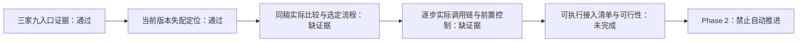

# Phase 1：成熟工作流与接管边界独立验收

**阶段目标：** 确定选中成熟工作流的真实调用链、接管边界、版本状态和可执行接入清单。
**状态：gaps_found；14/17 条合并 must-haves 验证通过；BASE 需求 2/4 满足。**
**验证时间：** 2026-10-15T11:58:35Z。首次验证；目录中不存在此前 VERIFICATION，未发现覆盖豁免。未提交文件。

## Observable Truths

ROADMAP 四项成功标准优先；PLAN 可补充、不可缩小目标。BASE-01/03 与相应成功标准去重，BASE-02/04 的细节并入相应目标；其余决定单列。

| # | Truth | 状态 | 代码/资料证据 |
|---|---|---|---|
| 1 | 三家矩阵每项标明实测/仅发现/未实现/受阻，并链接证据。 | VERIFIED | THREE-PLATFORM-LIVE-RESULTS 的15条claim与evidence索引逐项连接，final检查覆盖三家×三入口；历史旧引用反例没有删除。 |
| 2 | 选定工作流逐步骤记录实际执行方、请求与状态契约；Agent/Skill 服务端生成是否可控必须有证据。 | FAILED — BLOCKER | evidence.selection.candidate_id=null；9个调查steps均required=false、控制unproven；并非已选完整流程。 |
| 3 | 当前版本与旧常驻方案差异可复现；明确过期模块的影响。 | VERIFIED | current-build的3个旧依赖本次404与桥初始化失败对应；新资源仅unknown。检查器绑定URL/HTTP/MIME/hash/exports；真实404伪造matched反例通过。结论限2026-10-15采样，非保证长期兼容。 |
| 4 | 形成后续接入清单；若关键步骤无法接管，记录阻断原因并进入明确的范围决策，不伪装可行。 | FAILED — BLOCKER | 19项交接存在，但并非已选流程的可执行映射；真实final完整度false、可行性unassessed，范围状态pending_evidence。 |
| 5 | D-04：证据合同、真实观察、可行性分开；历史反例保留边界。 | VERIFIED | validate_evidence返回独立指标；三份报告明确历史/当前/配置层级。 |
| 6 | D-13：沿用已收口CONTEXT，任务卡引用已有决定。 | VERIFIED | 三PLAN需求、决定与CONTEXT对应；决策覆盖14/14。 |
| 7 | D-14：讨论与执行状态分开，逐卡测试/验收/提交可追溯。 | VERIFIED | 7卡SUMMARY具有命令、来源与提交；计划完成均明确不代表阶段完成。REVIEW-FIX如实记载CR-03曾提前提交、随后纠正并amend，不将此偏差掩饰成完美流程。 |
| 8 | D-01：Seko原站和Skill为当前入口，三家历史为参考。 | VERIFIED | 候选14/29来源、矩阵当前决策与交接一致。 |
| 9 | D-05：官方与真实玩家候选同输入比较，来源缺失阻断选择。 | FAILED — BLOCKER | 来源和同稿元数据已存在，但实际输出/人工成本均未运行；不能把字段对比升级为真实工作流比较。与#2同根因合并一个gap。 |
| 10 | D-06：先完整度和人工操作，再质量/可控性；未观察次数未知。 | VERIFIED | selection.rationale明确排序；候选manual_actions为null，报告未填写0或宣称最少人工。 |
| 11 | D-07/08：原创短文戏仅比较输入，画风/生产输入格式开放。 | VERIFIED | selection.test_input.purpose与报告同稿段落明确限制，SHA-256绑定原文。 |
| 12 | D-02：图视频指向自有Flow并交接回填责任，实际接入后续实现。 | VERIFIED | model_routes及integration_items区分Phase2适配与Phase3回填。 |
| 13 | D-03：编剧拆镜配音口型剪辑保留厂家，媒体变化/误伤单列。 | VERIFIED | retained_media未知显式保存；历史SekoTalk首帧重生成不保留Flow动作写明。这里只验收调查披露，未认证当前服务无误伤。 |
| 14 | D-09：首次生成外同模型最多两次质量重做，未知提交先核对。 | VERIFIED | validate_final的policies与handoff逐字段一致；报告明确是后续约束。 |
| 15 | D-10：失败镜头及依赖暂停、独立镜头继续、全部合格才出片。 | VERIFIED | handoff三项策略与报告交接一致；本阶段不声称已实现调度。 |
| 16 | D-11：质量重做与依赖调度归后续阶段。 | VERIFIED | owner_phases明确generation=2、backfill=3、scheduling=3/4、voice=5、overall=6。 |
| 17 | D-12：真实产品未决选择一道题、接受自由说明，不重问实现细节。 | VERIFIED | 报告保留交接规则；目前为缺证据而非已证技术不可能，未制造范围选择题或擅改范围。 |

**评分：14/17。** 运行/控制链本身缺失属于FAILED，不误标为单纯PRESENT_BEHAVIOR_UNVERIFIED；后者计数0。七条无描述符禁止项另外保留WARNING，未计作已验证真值。

## Required Artifacts / Key Link Verification

三个PLAN的verify.artifacts分别4/4、3/3、3/3，verify.key-links均2/2（均exit 0）。这些工具只证明存在/模式，人工检查进一步发现目标链未闭合。

| Artifact | 实质与连接检查 | 判定 |
|---|---|---|
| scripts/workflow_evidence_probe.py | main解析真实JSON，分阶段调用校验，输出独立合同/完整度/可行性/推进结果 | VERIFIED（离线检查器） |
| tests/test_workflow_evidence_probe.py | 独立预设fixture与反例，实际断言拒绝/不完整，不只有符号存在断言 | VERIFIED（检查器逻辑） |
| evidence.json | 36证据、15声明、2候选、9调查步骤、19接入项，引用及哈希由本次CLI验证 | VERIFIED（调查记录）；非完整真实链 |
| current-build.json | 10模块按current/cached/archived分开；3当前旧依赖404，与桥旧imports对应 | VERIFIED（本次兼容调查） |
| THREE-PLATFORM-LIVE-RESULTS.md | claim_id→evidence_ids→历史实际档案/源码，入口范围与失败反例明确 | VERIFIED |
| SEKO-BUILD-COMPATIBILITY.md | 三旧模块与新模块/缓存/归档差异及影响完整 | VERIFIED |
| SEKO-WORKFLOW-BOUNDARIES.md | 候选/步骤/路由/交接有实际内容，但明确未选定流程 | PARTIAL — 目标缺口已计入#2/#4 |
| 01-VALIDATION.md | partial、nyquist_compliant=false，真实待验项保留 | VERIFIED（覆盖记录） |

| From → To | 实际检查 | 状态 |
|---|---|---|
| 矩阵 → evidence → artifact_path/sample | hash、平台/入口、claim范围及报告引用一致 | WIRED |
| CLI main → validate_evidence → 各阶段 → final输出 | 本次实际执行final，所有命名检查无失败 | WIRED |
| current-build → extension/seko_page.js | 旧LoginContext/canvas/uploader路径和required_exports对应 | WIRED（失配调查，非线上正常运行） |
| 候选 → 选定流程 → 必需步骤 → 接入项 | candidate_id=null；全部required=false；选定链不存在 | NOT_WIRED — BLOCKER |
| audit/build_module_ids → 步骤控制证明 | 引用结构闭合；没有当前真实控制观察 | PARTIAL — 不足认证前置控制 |

## Data-Flow Trace（Level 4）

无前端渲染改动；检查报告值的来源，不虚构UI验收。

| 输出值 | 来源 | 判定 |
|---|---|---|
| 矩阵与版本记录 | 真实归档文件/脱敏采样→SHA校验→声明/模块比较→CLI | FLOWING；限已记录观察范围 |
| comparison_complete | candidates的真实运行绑定与输出/人工记录 | 本次false；诚实暴露未运行 |
| report_complete / feasibility / ready_for_phase2 | selection、required步骤、执行层证明、构建与handoff | false / unassessed / false；不是静态成功值 |
| 图片/视频目标key | agent/models.json、flow_batch映射与ev-model-flow-catalog | 配置来源真实；不是候选真实调用 |

九类writing/storyboard/image/video/voice/lipsync/edit/export/review均有当前与目标栏。图片NANO_BANANA_2_1→BELUGA、Omni frame_to_video 8秒→abra_i2v_8s与本地目录一致。GMLM显示/历史preferModel、42/30音色ID、sensetime服务码、review配置claude/model=null分别披露，未冒充实际生成型号。补充路由验收通过仅指准确披露和配置精确对应。

## Behavioral Spot-Checks / Counterexamples

本验证器独立执行下列5个命名unittest，全部OK，0.135秒。完整命令形式为：
`python3 -m unittest tests.test_workflow_evidence_probe.WorkflowEvidenceProbeTests.<test_name> -v`。
实际一次命令列出以下五个完整测试名；没有重跑全仓测试。

| 修复 | test_name | 反例与独立结果 |
|---|---|---|
| CR-01 bd375ef | test_candidate_comparison_requires_bound_current_run | static/source/historical、过期/错audit/候选/输入/运行ID均不能认证同稿实际比较；PASS |
| CR-02 5740ba6 | test_actual_404_samples_cannot_support_forged_matched_rows | 实际JSON三个404样本对应伪造200/matched行被拒绝；PASS |
| CR-03 4dd0d79 | test_model_route_cross_type_mode_duration_and_alias_rejected | 图片key冒充视频、错模式/时长/别名被拒绝；PASS |
| CR-04 ecdad55 | test_final_unknown_trigger_blocks_both_complete_conclusions | feasible/blocked两分支unknown触发不能完整/解锁；诚实降为unassessed可保存；PASS |
| CR-04 ecdad55 | test_final_trigger_requires_matching_execution_observation | step/method/path/event观察错配不能解锁；PASS |

四个提交均由git show确认存在，并检查实际函数实现。CR-01运行层级与候选/同稿/run绑定、CR-02同一响应字段绑定、CR-03精确目录查找、CR-04trigger_proven进入fully_observed，均在当前代码中；不是仅采信REVIEW-DISPOSITION。

**测试质量：** 相关测试未发现skip或TODO；fixture写入临时目录用于输入，期望是人工指定false/拒绝及固定独立字段，不是由被测函数生成期望值。通过的合成正向fixture只能证明检查器分支，不能证明真实Skill执行。已找出的部分需求是BASE-02/04；未覆盖的外部真实失败/恢复时序是待取证项，不能由该fixture填平。

父执行器记录107 Python+16 Node通过属于上游范围回归，本报告不冒充独立重跑该123项。本次只独立运行上述5项关键反例和真实final。

## Probe Execution

| Probe | 命令 | 实际结果 |
|---|---|---|
| final（递归覆盖tracer/matrix/build/candidates/steps/controls） | `python3 scripts/workflow_evidence_probe.py --evidence docs/benchmarks/workflow-boundaries/evidence.json --build docs/benchmarks/workflow-boundaries/current-build.json --stage final` | exit 0；contract_valid=true；comparison_complete=false；report_complete=false；feasibility=unassessed；ready_for_phase2=false；failed_checks=[] |

使用实际时钟，未注入过去时间以延长真实证据有效期。未发现本阶段另行声明的probe shell脚本；未启动服务、未线上调用/派发/生成。git diff --check通过。

## Requirements Coverage

| Requirement | 来源 | 描述 | 状态/证据 |
|---|---|---|---|
| BASE-01 | 01-01 | 三家能力与不同入口接管范围 | SATISFIED；矩阵15声明、九入口、历史失败/范围边界及引用验证 |
| BASE-02 | 01-02/03 | 选中Seko流程逐步真实执行及生成前边界 | BLOCKED；未选候选、未同稿运行、前置控制未知 |
| BASE-03 | 01-02 | 当前版本匹配与过期模块影响明确 | SATISFIED；本次三旧模块404及桥失败，缓存/归档不冒充当前 |
| BASE-04 | 01-03 | 可执行接入清单及真实可行性/具体技术阻断 | BLOCKED；交接清单有内容，实际必需流程与可行性未评定 |

全部四项均有PLAN归属，无孤儿需求。没有将Phase2真实Flow生成、Phase3生产回填、Phase4恢复、Phase5声音口型、Phase6整集实现当成Phase1缺陷；但选中流程的调查/真实边界本身属于Phase1，不可按后续Phase3实现目标延期消除此处gap。

## Decision Coverage / Anti-Patterns

决策覆盖owner命令返回：**All trackable CONTEXT.md decisions are honored by shipped artifacts.** honored=14/total=14/not_honored=[]。这是文档覆盖，不是运行目标完成。

源文件、测试与三份报告未发现无关联TBD/FIXME/XXX、跳过测试或伪装成功的占位返回。unknown/null在真实调查记录中有具体原因，且检查器保持不完整，不能因其诚实记录便将阶段判通过。早期报告34/62测试数是原任务历史计数；最新修复范围以REVIEW-FIX为准。

安全报告L1记录12项缓解已读；本验收仅复核当前离线检查器/资料界限，不提升为生产安全认证。无前端改动，UI审查不适用。

## Prohibitions / Human Verification Required

**unverified-prohibition — human review recommended：7项。** PLAN均为verification=null、unresolved，无可自动认证的执行描述符。本次LLM判断仅为NON-AUTHORITATIVE：读取代码/差异及报告没有发现上述禁止行为，但不能用这次判断自动销项。四条unclassified/unresolved假设也未擅自关闭。

| 禁止项 | 当前可见证据 | 处置 |
|---|---|---|
| 旧素材/静态/模拟冒充接管 | 报告分层、实际final为false | WARNING；保留人工复核 |
| 安装/静默换提供方或型号 | 工具标准库、路由automatic_substitution=false、精确key反例 | WARNING；保留人工复核 |
| 伪造玩家或宣传冒充执行 | 14/29身份来源明确、输出advertised | WARNING；保留人工复核 |
| 旧缓存/历史404冒充当前 | current/cached/archived分列、404字段绑定测试 | WARNING；保留人工复核 |
| 盲跑Skill或失败改厂家生成 | 本次无外部调用；资料记录未使用候选 | WARNING；不能用离线代码证明全部过去行为 |
| 后置/空/静态/缺登录冒充控制或不可能 | controls与final门槛、真实unassessed | WARNING；保留人工复核 |
| 提前实现后续生产功能代替调查 | 范围是离线检查器与报告，责任分期 | WARNING；保留人工复核 |

人工终检需逐项确认禁止行为的调查会话/变更范围；预期七项均有明确接受/不接受结论。完整真实工作流取证是上方BLOCKER的工作内容，不应仅要求用户点击“验收通过”替代实施。因为总体已有gaps_found，禁止项警告不改变这一更严格状态。

## Gaps Summary

两组阻断：**真实候选选择与逐步控制链缺失**；**基于该链的可执行清单和可行性尚未成立**。3/3调查计划与7张卡完成、四个代码审查问题修复，并未完成阶段目标。当前既不能宣称可行，也没有充分证据判整条Seko流程技术不可能。继续Phase1取证；Phase2不得自动推进。禁止盲跑厂家图视频，禁止静默替换模型或范围。

Fingerprint由指定gsd-tools verification.fingerprint产生并原样复制，自动纳入PLAN/SUMMARY；覆盖实现、证据、验收前置资料，排除STATE、ROADMAP和本报告。缺失私有归档会显式导致验证失败，不生成替代物。

_Verifier: gsd-verifier；独立验收；未提交。_
