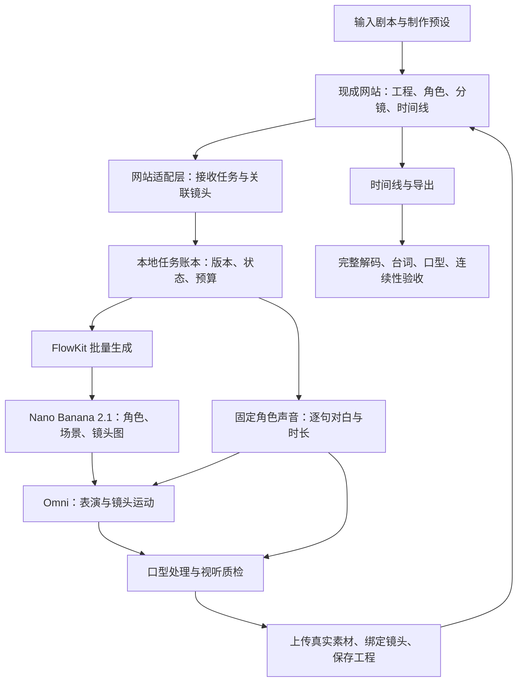

# 漫剧工作台：现成网站接入自有 Flow

日期：2026-10-13。状态：方案与任务卡已建立；R02 进行中，OiiOii 已完成真实素材上传、自动剪辑和 16 秒渲染；接管实现、文戏样片和整体验收尚未完成。修订：LibTV/OiiOii 官方工具已安装，见 [实测记录](THREE-PLATFORM-LIVE-TEST.md)。

## 1. 已确认的目标

- 输入剧本，自动完成角色素材、分镜、对白、视频、口型、剪辑和交付。
- 横屏 16:9，每集 3–5 分钟；以文戏、情绪表演、日常轻动作为主。
- 固定角色音色，保留准确台词；所有正面说话镜头必须对口型。
- 主路线：复用 libuai、Flova 等现成网站的工作台，将生成任务接到自有 Flow，再把真实结果写回工程。
- 用户表示在另一台电脑上实测过接管路径；本机尚未复现。用户要求继续规划，不再索要旧网址与记录。
- 优先复用 GitHub 上成熟组件。只开发网站适配、Flow 转换、任务关联和验收规则等必要连接部分。
- 禁止兜底：不能自动换模型、换网站、重新启用原站生成、用静态图片替代失败视频、伪造完成或跳过口型。
- 遵循方案 → 任务拆解 → 任务卡 → 执行 → 测试 → 验收 → 提交。每个里程碑及整体单独验收。

画风尚未固定；横屏不代表写实。首个样片采用实际计划使用的画风测试，不能以真人口型测试代替二维角色测试。

## 2. 已有证据与待验证项

| 项目 | 证据 / 状态 |
| --- | --- |
| FlowKit | 本机健康检查通过，扩展 0.5.2 已连接 |
| Nano Banana 2.1 | BELUGA 已实测生成图片 |
| Omni | Omni 1.1 Flash / abra_i2v_8s 已实测生成 8 秒视频 |
| 人物、对白与口型 | 尚未验证；此前样片为竹林风景 |
| 网站接管及回填 | 用户报告曾实测；本机需建立可重复的验收记录 |
| Flova 自动操作 | 官方 CLI 文档支持项目、上传、进度、导出；不等于已支持自定义生成提供方 |
| 真实费用 | 尚无余额差额证据，不能用 FlowKit 的套餐配置接口当作真实余额 |

既有实测见 [LIVE-GENERATION-TASKS.md](LIVE-GENERATION-TASKS.md)。

## 3. 主架构

本地账本是 Flow 任务与原站工程之间的关联记录；原站继续保存工程、分镜与时间线。两边通过真实任务 ID、素材 ID、镜头版本关联，不能仅修改页面显示。

### 接管边界

先为选定网站建立接口清单，分别识别：项目读写、剧本/规划、生成提交、任务状态、素材上传、素材绑定、时间线及导出。按类别接管，不能把网站全部接口屏蔽。

1. **浏览器发出的生成任务**：在提交前转给本地适配层，同时适配原站所需的轮询或事件进度和错误结构。原站生成请求不能先发出再拦响应，否则可能双重消耗。
2. **原站服务器内部发出的生成任务**：浏览器代理无法看到。必须验证原站工具接入、规划与执行分离、或已有素材导入是否足够完成用户要求；未证明可行时该站接入停在 BLOCKED。
3. **工程保存与导出**：需要原站认可的持久素材记录。云端不能直接读取本机路径或 localhost；采用原站支持的素材上传/导入后再绑定，刷新和重开工程都必须有效。
4. **真实进度**：可以把真实状态转换为原站需要的格式，不能凭等待时长宣称完成。只有媒体可读、上传完成、绑定成功后才进入完成状态。
5. **原站功能**：保留正常登录、工程权限、素材和导出流程。自有 Flow 替换生成不代表原站 Agent、存储、订阅或导出费用消失；这些费用在接口验证时单独记录。

先完成跨平台比较，再选主工程平台，首版集中实现获选平台的接管闭环。Flova 与其他候选同等评估，不因存在 CLI 就预先选中。平台比较见 [COMIC-PLATFORM-COMPARISON.md](COMIC-PLATFORM-COMPARISON.md)。Liblib / LibTV 是本次独立查到的候选，不视为已经确认用户所说的 libuai。不同网站不共用未经验证的接口假设，也不在失败时自动切站。

平台选择按两条线比较：创作工具是否适合文戏漫剧，以及这些工具在改用自有 Flow 后是否仍然有效。可以在设计阶段选择主工作台与专用工具组成固定流程；不能把平台自有模型能力算作替换成 Flow 后仍会保留的工作台能力。

## 4. 工具选型：复用优先

| 工具 | 角色 | 选型状态与边界 |
| --- | --- | --- |
| [Flova 官方 CLI](https://www.flova.ai/en/docs/features/flova-cli/) | 项目读写、上传、读取进度、导出 | 接入候选之一；官方集成工具，不标称开源，也不据此认定可替换模型 |
| [mitmproxy](https://github.com/mitmproxy/mitmproxy) | 接口分析与接管原型 | 成熟 MIT 项目；限定任务浏览器及目标域名。是否进入长期运行链路由 M0 验证决定 |
| 现有 FlowKit | Flow 图片/视频批量请求、限速、状态 | 已有实测，沿用现有服务和批量 API；审计并关闭接入路径上的隐式降级 |
| [WXT](https://github.com/wxt-dev/wxt) | 网站适配扩展的工程框架 | 只有 M0 确定需要常驻浏览器扩展才引入；不同时维护两套拦截执行器 |
| [CosyVoice](https://github.com/QwenAudio/CosyVoice) | 中文固定音色、情绪对白 | 评测候选，仓库 Apache-2.0；部署硬件、模型权重及实际语音表现待样片验证 |
| [MuseTalk](https://github.com/TMElyralab/MuseTalk) | 已生成视频的口型处理 | 评测候选；官方明确存在脸部细节变化、抖动及面部处理分辨率限制；漫画角色适用性未证实 |
| [FFmpeg](https://github.com/FFmpeg/FFmpeg) | 规范音视频、字幕、混音、检测 | 复用已安装工具与项目处理能力；按最终构建核对依赖许可 |
| [Playwright](https://github.com/microsoft/playwright) | 接管链路、刷新、重开、导出的回归测试 | 开发阶段使用成熟测试框架；当前规划阶段不安装、不运行网站操作 |

不重做网站画布、剪辑器、账号系统，不训练新的生图/视频模型。调度先复用现有队列与数据库；根据恢复测试补齐必要的跨步骤状态，不先引入另一套完整工作流平台。

已检索的完整漫剧项目包括 [Toonflow](https://github.com/HBAI-Ltd/Toonflow-app)、[AID Studio](https://github.com/gzxx-2025/aid-studio)、[Moyin Creator](https://github.com/MemeCalculate/moyin-creator)、[Huobao Drama](https://github.com/chatfire-AI/huobao-drama)。当前方向已转为现成网站接管，因此本期不部署这些整套平台。仓库热度和 README 的生产级描述不能代替集成验证。

## 5. 文戏生产规则

### 剧本与资产

- 编译出章节、场景、镜头和逐句对白；每句保留原文、角色、情绪、顺序及来源位置。不得为满足时长静默删改台词。
- 每个角色固定角色 ID、外观参考、服装版本和声音版本；参考素材全部成功后才生成镜头图。
- 每个镜头记录场景、出镜角色、说话角色、台词、运镜、动作、参考素材版本和目标时长。
- 优先单人正反打、双人中景、表情特写、停顿、反应镜头和小动作。真实剧本中的激烈打斗标为超出首版范围并暂停相关段落，不擅自改写。

### 先确定对白，再安排镜头时长

固定音色逐句生成语音，校验台词并测量时长，再编排 Omni 镜头。镜头超过模型已验证时长时按对白停顿拆镜，不能加速语音、截断台词或拉伸画面掩盖不匹配。

Omni 用于视觉表演；正面对白进入经验证的音频驱动口型步骤，最终保留同一份准确对白音轨。原生生成的对白不能直接视为固定音色和逐字准确。要保留环境声并处理原视频中的重复人声。

3–5 分钟按每镜头平均有效 6 秒估算约 30–50 个镜头，仅用于容量规划。最终数量取决于实测对白时长；模型生成时长可能大于可用剪辑时长，两者分别计费与统计。

### 自动化质量门槛

- 台词：脚本文本和字幕逐句一致；语音转写差异会阻止交付并进入逐句复核/重生成，不能只凭文字相同认定音频准确。
- 声音：固定同一角色声音版本；不同情绪、长短句与跨镜头音色一致性在样片中人工验收，建立自动评分基准。
- 口型：所有正面对白镜头都覆盖检查。建议初始音画起止偏差目标不超过 120 ms，辅以音素口型匹配、闭口停顿与画面检查；仅起止同步不构成口型通过。阈值在 M1 校准。
- 视觉：检测身份、服装、场景、说话人、闪帧及口型处理损伤；原有单项视觉总分不足以判定整片合格。
- 自动检测可筛查，不能宣称等同于人的审美判断。M1 和整体验收保留人工观看；通过后的常规生产按固定预设自动推进。

## 6. 任务卡与里程碑

实施任务均为待执行。没有将研究结论记为产品完成。新增 M-1 平台选型关卡；文档初筛已经完成，真实工程比较仍待执行。

| 里程碑 / 任务卡 | 工作与交付 | 依赖 | 测试和验收 |
| --- | --- | --- | --- |
| M-1 / R01 平台文档初筛 | 比较 10 个平台的创作工具、外部素材、自动化入口、模型依赖 | 无 | 已完成文档比较；来源、未知项与未实测状态明确 |
| M-1 / R02 同题实测选型 | 候选主平台中选 3 个做相同双人文戏工程，另核验文档明确的接入工具 | R01 | 保留分镜、任务、回填、刷新、导出及成本证据；据此确定主平台，不预定 Flova |
| M0 / T01 网站接口清单 | 记录获选站浏览器与服务端边界、生成入口、素材导入、任务和时间线协议 | R02 | 对每类操作提供真实请求/响应结构和可接管结论；证据去除凭据 |
| M0 / T02 单镜头闭环 | 站内发起 → Flow 生图/视频 → 回填 → 保存 → 时间线导出 | T01 | 各一项真实图片/视频任务；原站生成未提交；刷新、重开、导出均读到同一结果 |
| M1 / T03 声音与口型实验 | 固定两个角色，覆盖不同情绪、短句/长句、正面/小幅转头 | T01；可与 T02 独立推进 | 台词无增删、音色稳定、正面口型通过；记录运行硬件、时间、费用和缺陷 |
| M1 / T04 30–45 秒对白样片 | 约 6–8 个文戏镜头，实际目标画风，完整声音/视频链路 | T02、T03 | 人工观看通过角色、对白、口型、连贯性；未通过不启动整集规模生产 |
| M2 / T05 剧本编译和角色库 | 剧本 → 稳定 ID、角色/场景参考、对白、镜头计划 | T04 | 原文逐句可追踪；角色/声音/服装锁定；缺失资料明确阻断 |
| M2 / T06 统一任务与站点适配 | 参数转换、ID 关联、真实状态、素材上传/绑定、错误传递 | T02、T05 | 原站状态与本地状态一致；取消、超时、素材失效和版本变化可定位 |
| M3 / T07 自动生产与预算 | 完整批量队列、同版本去重、恢复、重生成依赖、预算 | T06 | 重启恢复、重复点击不重复提交；预算上限阻止新收费提交；失败不会转原站生成 |
| M3 / T08 质检及成片 | 逐句检测、口型/视觉检查、混音字幕、时间线、MP4 导出 | T04、T07 | 修复限于失败镜头；原有已通过素材可复用；完整媒体解码、字幕和时长通过 |
| M4 / T09 整集验收 | 一份 3–5 分钟剧本自动产出一集，随后连续 3 集稳定性验证 | T08 | 常规流程无逐镜点击；16:9、台词完整、声音一致、正面口型全部通过；记录实际成本 |
| M4 / T10 故障验收与提交 | 网站协议变化、断网、登录失效、进程退出、结果不明、导出失败 | T09 | 无假完成、无自动替代、无盲目重复扣费；异常清晰，恢复后可继续；留存交付和版本证据 |

每个里程碑交付实现、测试结果、真实媒体/工程证据与已知阻塞项。通过后单独提交；不把任务卡勾选当作验收。M0 和 M1 给出实际可行性后再估工期和整集成本。

## 7. 状态、恢复与无兜底约束

状态至少包括 PENDING、RUNNING、SUCCEEDED、FAILED、BLOCKED、CANCELLED、RECONCILING。上游结果不明时进入 RECONCILING，先核对真实任务，不重新提交收费任务。

- 去重键覆盖项目、镜头、步骤、素材版本、模型及参数；相同执行重入可查回原任务，主动重生成必须创建新版本。
- 请求提交前记账，保存上游任务 ID；无法确认提交是否成功且上游没有幂等能力时暂停人工核对，不宣称“绝对只扣一次”。
- 只重试已确认失败且允许重试的同一任务。单镜头最多两轮质量修正，预算先行；仍不合格则 BLOCKED。
- 失败、取消、登录失效、接口变更和预算不足均保留真实状态。不能自动打开降级开关、调用其他模型或恢复原站生成。
- 改角色参考图会使依赖镜头图、视频、口型和成片失效；改台词会使声音、时长、相关视频/口型及成片失效。仅重跑受影响依赖。
- 素材保存持久标识与校验信息，不依赖即将过期的签名 URL；回填失败先核对导入结果，避免重复素材记录。
- 当前 Flow 仍依赖保持登录的浏览器与扩展；无人值守运行必须监测连接和会话，登录过期明确暂停。
- 本地桥仅接收明确允许的站点与任务，站点凭据不转发到 Flow；日志去除 Cookie、令牌和签名链接。
- 成本区分 Flow、网站自身服务、语音/口型算力和重试。真实价格未知时先限制生成次数/秒数，不能显示虚构余额。

## 8. 整体交付与验收

交付：可重开的原站工程、最终 MP4、SRT、角色与声音版本、逐镜素材、任务账本、真实费用/用量记录、启动及异常恢复说明。

整体通过条件：导入符合首版范围的 3–5 分钟剧本并选择已验收预设后，常规路径自动完成；最终人工抽查/观看通过，故障测试显示任务明确停止而不是替代输出。首版画面分辨率以验证过的规格为准，当前仅有 720p 视频实证，不承诺原生 1080p/4K。

初版交付为规划与任务卡。用户随后授权实测三站并要求下载可用工具：现已安装 LibTV CLI、OiiOii CLI 和 OiiOii 官方桌面端；没有安装 ComfyUI 或下载本地生成模型。登录后 OiiOii 技术链路结果见 [实测验收](OIIOII-FLOW-LIVE-RESULT.md)。此前对实测额度的授权仍保留，本轮尚未提交新的收费生成任务。

## 9. 本次规划自检

- 已纳入用户确认的横屏 3–5 分钟、固定声音、精确台词与正面口型要求。
- 已将现成网站接管定为主路线；未将自建工作台作为隐式替代路径。
- 已区分官方文档能力、本机实证、用户报告和待验证项。
- 每张实施任务卡均给出依赖及验收，实施状态统一为待执行；R01 仅标记文档比较完成。
- 已列出提交前接管、服务器边界、持久回填和重复收费四项关键验证。
- 方案自检不代表用户验收，也不代表网站接入或整片制作完成。

## 10. 主要来源

- [Flova CLI：项目、素材、进度、导出](https://www.flova.ai/en/docs/features/flova-cli/)
- [Flova Skills：可复用创作流程](https://flova.tv/en/docs/features/skills/)
- [mitmproxy](https://github.com/mitmproxy/mitmproxy)
- [WXT](https://github.com/wxt-dev/wxt)
- [CosyVoice](https://github.com/QwenAudio/CosyVoice)
- [MuseTalk：能力、限制及许可](https://github.com/TMElyralab/MuseTalk)
- [FFmpeg](https://github.com/FFmpeg/FFmpeg)
- [Playwright](https://github.com/microsoft/playwright)
