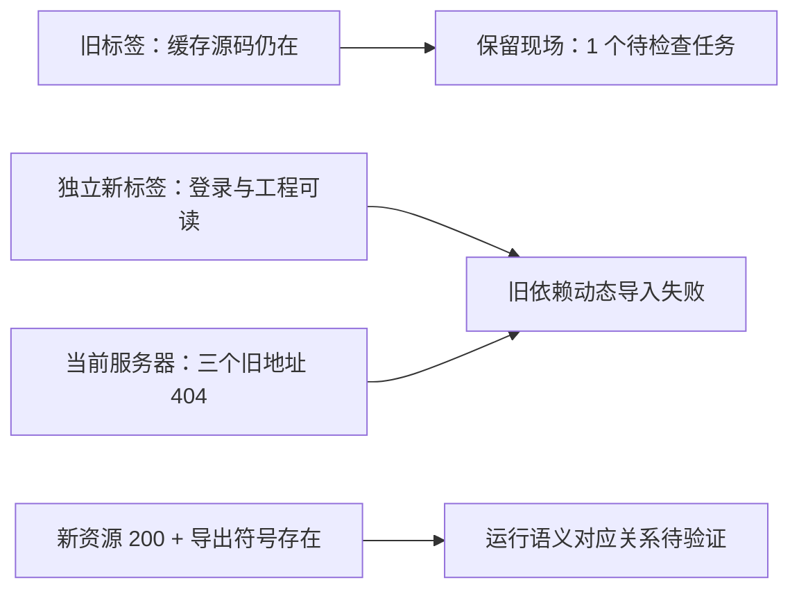

# Seko 当前构建与桥兼容性

审计 `workflow-boundaries-20261015`；服务器样本时间 **2026-10-15 11:10:59 UTC**。本次新标签实际启动失败，bridge=**blocked**；这是具体版本失配，不是登录失败，也不等于无法接入 Seko。

## 当次来源与独立状态

结构化事实：[current-build.json](benchmarks/workflow-boundaries/current-build.json)；所有 evidence ID 对应 [evidence.json](benchmarks/workflow-boundaries/evidence.json) 的脱敏采样与 SHA-256。哈希绑定记录和响应字节，不自动证明业务语义。

| 核对项 | 实际观察 | 证据与边界 |
| --- | --- | --- |
| 本机健康 | `/health` status=ok，1.3.1，extension_connected=true，扩展0.5.2，authenticated_connections=0 | `ev-build-health`；只证明本机 Flow 连接，不能推断 Seko 鉴权 |
| 站点登录 / 工程 | 独立新标签显示登录问候、原工程画布、已有图片和视频 | `ev-build-page`；未导出登录凭据 |
| 桥初始化 | 新标签显示 `Failed to fetch dynamically imported module: .../canvas-BZat8bJg.js` | `ev-build-page`；按源码 start 顺序，已越过 config 读取和工程选择，停在模块导入。未单独暴露或复用桥密钥 |
| 旧现场 | 新版本提示；5 个完成、1 个待检查 | `ev-build-page`；未刷新旧标签，未重发结果未知任务 |

## 现有桥逐依赖核对

源码 `extension/seko_page.js` 的硬编码导入位于 start；实际使用 LoginContext 的 `Y/g/k`、canvas 的 `an/D/b`、uploader 的 `m`。前者承担上传及客户端 post 包装，中者读取画布/创建节点/读回节点，后者内容检查。不能只看同名字母就认定语义等价。

| 现有依赖 | archived / cached | current 服务器 | 影响 |
| --- | --- | --- | --- |
| LoginContext-CFHyujin.js | sources.json 无该条；旧标签 Debugger 读到 Y/g/k，哈希 `cd326508…` | 404，text/plain，9 bytes；`ev-build-http-0` | 不能重新加载旧客户端/上传依赖 |
| canvas-BZat8bJg.js | 2026-10-14 归档及旧标签哈希同为 `95e89d95…`；an/D/b 存在 | 404，text/plain，9 bytes；`ev-build-http-1` | 新标签实际 import 失败，无法启动定向转交 |
| useOSSUploader-BaPQIV7u.js | sources.json 无该条；旧标签 m 存在，哈希 `e65a420c…` | 404，text/plain，9 bytes；`ev-build-http-2` | 不能重新加载旧内容检查依赖 |

三条当次 404 的响应体 SHA-256 均为 `e3ebaa16dd9d9b9fc107c42183fb6cf9d22927e1af03dbbdfa0ccc38e4e4ac31`。这是本次读取结果，未复制历史404。尤其 LoginContext 的历史200与今天404必须分开。

缓存证据 `ev-build-cache-0/1/2` 通过 CUA CDP Debugger.scriptParsed/getScriptSource 只读提取，仅记录需要的导出符号；原始HTTP状态未保留，字段为 null，compatibility=unknown。归档 `ev-build-archive` 对应本机 sources.json/rea-input，原文件只读，缺失会被报告，不写替代归档。旧缓存不能证明当前服务器可用。

## 当前页面实际资源

| 页面资源树观察到的模块 | 服务器响应 / SHA-256 | 对应关系与结论 |
| --- | --- | --- |
| LoginContext-Dre9Pek8.js | 200 JavaScript；443596 bytes；`0d4ac281…` | 静态导出含Y/g/k；`ev-build-http-3`，运行语义未证实，unknown |
| canvas-BLeYbv0U.js | 200 JavaScript；20458 bytes；`5d043cb3…` | 静态导出含an/D/b；`ev-build-http-4`，运行语义未证实，unknown |
| useOSSUploader-BWv-OPvK.js | 200 JavaScript；7540 bytes；`c53cd283…` | 静态导出含m；`ev-build-http-5`，运行语义未证实，unknown |

这些地址来自独立新标签 Page.getResourceTree，随后同源 GET（cache=no-store、credentials=omit）计算响应字节哈希、状态、内容类型及 export 子集，没有执行新模块函数或修改桥。并未按文件名前缀自动认定替代关系。现有桥仍指向旧路径，因此新资源可读不改变 blocked。

补充采样路径：Python 标准库直接请求遇到本机证书链校验错误，未关闭校验；系统 curl 正常核验得到旧 LoginContext 404；最终六模块统一采用浏览器同源只读采样。没有安装证书或软件。

## 测试与验收

`python3 -m unittest tests.test_workflow_evidence_probe -v`：34 tests 通过。build CLI 对实际27条证据、15条声明、10条模块观察返回 contract_valid=true，feasibility=unassessed。测试拒绝错误audit、陈旧/未来/历史冒充当前、200 HTML、缺导出、哈希脱链、空模块、无实际启动证据却写ready。

`python3 scripts/workflow_evidence_probe.py --evidence docs/benchmarks/workflow-boundaries/evidence.json --build docs/benchmarks/workflow-boundaries/current-build.json --stage build`

执行器已逐项复核当前页面、真实响应与源码所需符号；这属于证据验收，不冒充用户本人或整阶段验收。current观察有效期24小时，阶段验收超时须重新只读采样。后续先验证新模块实际契约并建立兼容适配，再测试重开；本卡没有修改生产桥、提交生成、上传素材或更换模型。
