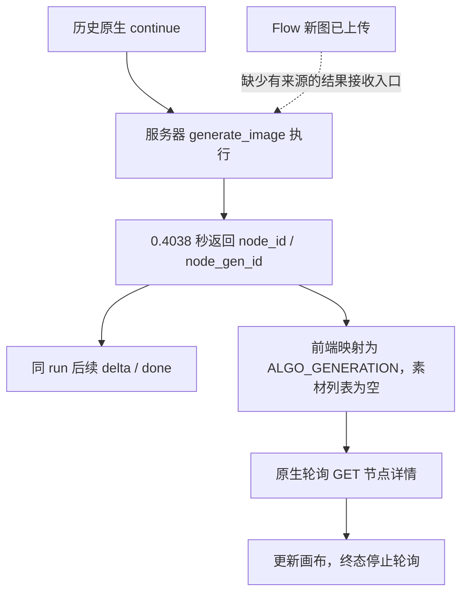
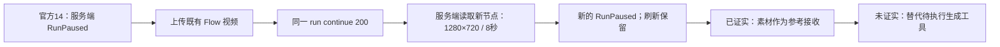
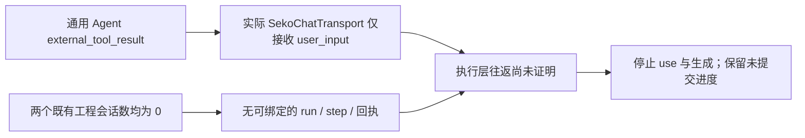

## 回执绑定与工具配置核对：执行依赖仍在服务端

记录 2026-10-15T15:25:58.289099Z。用户将下一步选择交由助手决定；本轮使用现有账号与本机材料核对接入能力，没有假定获得厂家后端权限。01-04-01 仍未验收，0/7。

| 新核对项 | 结果 |
|---|---|
| 当前账号实际页面 | 社区、我的空间、个人中心未观察到自定义生成服务配置；该范围不代表所有隐藏入口或账号等级 |
| 已加载 settings 模块 | 实际为界面本地化字典，不是提供商配置代码 |
| 实际 Skill 详情模块 | 展示、点赞与使用入口，未实现自定义工具注册 |
| 已取服务器 Skill 配置合同 | ConfigOptionId 列出8个固定工具类型，未包含自定义工具类型；此项引用上一轮保存的1.9.0合同 |
| Flow 输出身份 | 新鲜回读 node 2110739812897325058 / gen 2110739812905713666，状态完成，与原真实上传回执一致 |
| 原生成工具 | run 236494255546613761 / call_1339172 仍等待；没有同工具 ToolCallCompleted |

REA 对本轮实际取得的两个模块完成分析，统计和证据ID见下方JSON。没有把源码搜索未命中或有限图覆盖当作远端不存在功能的证明。公开精确源码检索未找到对应实现，未取得服务器 generate_image 实现。

已保存可复用的 Flow 输出身份映射 `verified-flow-receipt-binding.json`，并用实际节点回读验证 node/gen 身份和完成状态；它明确标注**不是 Seko 请求体、没有提交、没有服务器接受回执**。没有把它填入猜测的 user_inputs 字段或伪造服务器事件。

当前需要解决的依赖已具体化：必须有一个能在厂家派发前，将该真实 Flow 输出绑定到 call_1339172 的服务器扩展点或完成协议。现有浏览器可以截住确认和上传文件；REA 可以分析已取得的客户端文件；两者并不自动提供远端服务器工具实现或控制权。未取得这种能力前，继续改前端显示与重复查询不能完成本卡。

本轮身份一致性断言通过；没有生产代码修改或单元测试变更。零新增生成、配置变更、安装、兜底、提交；后续卡未启动。临时确认屏障与原待执行页保留。路由仍为生图 NANO_BANANA_2_1→BELUGA、生视频 Omni abra_i2v_8s（8s/720p/横屏），本轮均无调用。

[脱敏记录与证据哈希](benchmarks/workflow-boundaries/gap-receipt-config-20261015.json)。完整源码与私有响应仅保留本机 output。

---

## 厂家真实完成链：工具返回任务身份，页面独立刷新素材

本轮记录：2026-10-15T15:17:27.405426Z；仅调查 01-04-01，0/7 验收，无提交。没有新增任何图视频生成；读取既有厂家对照任务，不将其计作 Flow 成果。

### 真实观察

- 从现有厂家成功记录继续追踪：run `236491385000267776` / tool `call_888730`；服务端持久化事件包含 generate_image 的 `ToolCallStarted → ToolCallCompleted → delta → done`，当前 run_status=10。完成结果为 node `2110736351703138305` / gen `2110736351711526914`，没有图片字节或素材 URL。
- 工具完成事件时间为 2026-10-15 **14:15:36 UTC**，自报用时 **0.4038 秒**。对该真实图片执行 HEAD，HTTP200，Last-Modified 为 **14:15:42 UTC**。这是对象存储时间，不能当作模型推理计时；但该工具回执没有等待这个文件落盘。
- 真实节点当前状态 GENERATING_COMPLETED，原厂 Z-Image、历史消耗1点；本轮没有再次生成或扣点。这个对照 run 结束，没有下一等待门，也不是 Flow 验收样本。
- 对已完成节点调用厂家导出的原生轮询入口，捕获无截断窗口和实际异步调用栈：`zL → Rb → Tb → BL → Be → ky → fetch`，最终 GET `/seko-api/seko-canvas/v1/canvas-node/2110736351703138305/detail`。在这个刷新窗口没有 Agent 完成/恢复写请求。该观察仅涵盖**已完成节点刷新**，不冒充新一轮完整生成的网络捕获。
- 读取当前构建的轮询模块后，源码终态路径为 `BL → HL → VL → hydrateNodeGenerationData`；有数据变化时 `Eb → AL → EI` 同步 canvasNodeCtx 到 PUT canvas。这个画布同步分支不提交 run/tool result；本轮数据未变的刷新没有观察到该 PUT。

### REA 与原文重放

新增实际 import 对应的 `PreviewNineGridNode-BxiW9DW9.js` 返回200 JavaScript。既有 REA 6.4.0 解析1文件、137569 AST节点、282 findings、0 parse failure；证据 `ev_08cdfcc544ec440c99674d5ffd1cdbe99b48b9e6d33191a09a59c2807953511f`。针对 BL / AL 的语义 trace 均只定位到种子函数、没有遍历关系，覆盖 partial，未知项分别12372/12364；**不能把 REA 图当成完整服务端调用图**。结论以精确源码、真实异步栈和服务端持久化事件交叉限定。

精确抽取当前 InfiniteCanvas 原文 Iee/W3 及图片分支依赖，使用厂家真实 ToolCallCompleted.result 离线重放：输出同 node/gen 身份、`ALGO_GENERATION`、materials=0；断言通过。这个离线重放证明前端如何解释回执，不是向服务器发送结果，更不是 Flow 接管成功。

### 接管位置与未关闭缺口

本次厂家样本的 Agent 控制流在创建任务并返回节点身份后继续；图片生成状态由画布独立轮询。因而“图片完成后浏览器通知 Agent 恢复”这条假设在当前链路中不成立。Flow 接管仍需让服务器正在执行/等待的 generate_image 接受 Flow 的真实节点回执，或使用有来源的服务端外部工具完成协议。不能把前端画布同步、伪造 ToolCallCompleted 或改显示状态作为替代。

尚未取得服务器内部 generate_image 的实现及服务间调用目标；公开前端和当前用户态请求栈看不到该内部调用。没有据此断言隐藏接口不存在，也没有猜测回调地址或注入结果字段。最终回读原目标 run `236494255546613761` 仍为30，待执行 `call_1339172`，Flow 结果尚未被该工具接受。临时确认屏障保留；临时异步调试设置已撤销。

模型路由不变：生图 `Flow NANO_BANANA_2_1 → BELUGA`；视频 `Flow Omni abra_i2v_8s / frame_to_video / 8s / 720p / 横屏`；厂家文字编排实际 `gmlm-3-flash`。零安装、零兜底、后续卡未启动。没有生产代码修改或新增单元测试；本轮验证是服务端回读、真实轮询取证和原文行为重放。

[脱敏记录、调用栈与证据哈希](benchmarks/workflow-boundaries/gap-native-completion-chain-20261015.json)。原始私有响应及第三方源码只保留本机 output。

---

## 服务器恢复深挖：同一生成工具仍未完成

本轮记录时间：2026-10-15T15:04:18.150419Z。仅处理 01-04-01；0/7 验收、无提交。

| 实测项 | 结果 | 验收含义 |
|---|---|---|
| 服务器公开 OpenAPI 与版本 | Agent MVP 1.9.0，部署 commit 439a587c | 已核对服务端声明，超出仅看前端的范围 |
| 同 run 详情 | 236494255546613761，run_status=30，generate_image / call_1339172 仍等待 | 新 Flow 图尚未成为此工具结果 |
| GET 同 run /stream | HTTP 200，重放相同 requirement c102ce4c-d52b-4728-a14d-371effb35480 | 重连成功不是继续执行；其中旧 Skill 读取的完成事件也不是生图完成 |
| 实际适配器原文离线行为复现 | 先 external_tool.completed，随后 external_tool.failed；server_posts=0 | 客户端“完成”不能作为服务器回执 |
| 真实服务器完成与下一门 | 未观察到 | 第一卡仍未通过 |

声明的 RunContinueRequest 只有 canvas_id、session_id、user_inputs；run 请求也未声明工具或供应商替换字段。user_inputs 内层允许任意键，故不能据此断言所有额外字段都会被拒绝；本轮没有向真实待执行工具注入猜测的结果字段，以免继续厂家生成。未发现声明的外部结果完成写入口；这不证明隐藏接口绝对不存在。公开的 agent-ops 是独立鉴权的只读诊断接口，本轮未调用，也未寻求访问凭据。

REA 使用既有 6.4.0，精确提取当前构建完整 SekoChatTransport 与通用宿主方法。解析 2034 个 AST 节点；continueRun/resumeRun 语义节点查询均 found，但覆盖 partial，分别有 7/21 个未知项。源码恢复引擎 Wakaru 未配置，保留失败原文，零安装。框架背景参照 [Agno external execution](https://docs.agno.com/hitl/external-execution)，其 external execution 与 user input 的区别不能直接转换成可调用的 Seko 接口。

优化验收检查：新增独立的服务器观察记录，绑定 run、tool、输出节点、ToolCallCompleted 和不同的下一等待点。9 个反例先 RED，修复后 Python 77 项、Node 3 项通过。此记录格式属于本项目证据合同，不是臆造的 Seko 请求协议；仍须人工核对原始服务器响应。gate 合同有效，tracer/control/channel 全 false。

模型路由保持：生图 Flow NANO_BANANA_2_1 → BELUGA；生视频 Flow Omni abra_i2v_8s（frame_to_video，8s，720p，横屏）；厂家文字编排实际 gmlm-3-flash。本轮没有新增图/视频生成，沿用上一轮新生成素材用于调查，并非宣称该素材已完成待执行工具。临时确认屏障与待执行页保留，未刷新；尚未常驻。

详细脱敏记录与原始材料哈希：[gap-server-resume-20261015.json](benchmarks/workflow-boundaries/gap-server-resume-20261015.json)。原始响应及第三方源码仅留本机 output 目录。

当前具体缺口是服务器的“同一待执行工具接受外部结果”契约。仅修改前端类型判断、上传节点、重连 SSE 均不足以补齐；需要有来源的服务器完成入口及真实回执，才能继续后续卡片。

---

# Seko 执行层控制取证：第一卡继续未验收

## 2026-10-15 新增：真正的生图等待已截获，新 Flow 图片已回填；原工具恢复仍未通过

用户后续明确允许修改适配器。因此新增隔离诊断适配器 `extension/seko_agent_handoff_probe.js` 和测试，未接入生产 manifest，未安装任何组件。原先问卷选择已由用户完成，原 run 236484960534499330 结束于文本大纲；保留这些选择。

| 环节 | 真实结果 |
|---|---|
| 首次诊断反例 | run 236491385000267776 / call_888730 在适配器启用前已收到原生确认；厂家 Z-Image 生成 node 2110736351703138305，积分80→79。明确不计 Flow 成果，未归因给用户或探针。 |
| 新诊断真实等待 | run 236494255546613761 / session 236494259887718401 / requirement c102ce4c-d52b-4728-a14d-371effb35480 / generate_image call_1339172。原生卡选择即梦5.0 Pro，1张16:9/1K。不是普通问卷。 |
| 生成前捕获 | 先安装当前标签的继续请求屏障，再绑定真实暂停事件。点击原生确认后捕获参数；完整观察窗口没有 /continue 请求，服务器 run_status=30、事件仍终止于 paused。 |
| 真正的新 Flow 调用 | 使用捕获参数经已有 batch API 提交，request e5f57fdb-a096-45d4-ae65-4b088ff88f0a；provider=flow；NANO_BANANA_2_1→BELUGA；26秒完成，retry_count=0。Flow 原站显示 Nano Banana 2.1 16:9。 |
| 新素材回填 | 原站上传器→图片审核 passed→创建 IMAGE 节点 2110739812897325058 / gen 2110739812905713666。重新下载原站节点文件与 Flow 原始字节 SHA256 完全相同：889397b365ad9c2bb5643b10681de7500f25e9194e4818c2a9259ab3ac8acd34。 |
| 尚未恢复 | 回填后同 run 仍为30，只有 skill读取/delta/paused，没有 call_1339172 的 ToolCallCompleted，也无下一门。不能以素材节点已完成替代生成工具已完成。 |

这次捕获、Flow提交、上传由助手分步连接，**尚不是自动的 capture→batch→原流程恢复桥**。诊断使用内置生图工具，没有附官方14或创作者29，不能提升候选比较资格。视频路由仍固定 Omni frame_to_video / abra_i2v_8s / 8s / 720p / 横屏，本轮未调用。

具体断点：实际 SekoChatTransport.continueRun 只接 user_input。离线用当前原文去掉类型守卫后，external_tool_result 的 result/toolCallId 仍被序列化丢弃，发出 user_inputs={}。此前HTTP422现已取得真实校验体：body.user_inputs too_short，字典至少1项。没有把外部结果塞进生成参数试运气，因为这可能继续厂家生成；没有伪造 ToolCallCompleted。这个事实证明现有客户端改一行不够，不证明服务器不存在其他契约。

REA 使用既有6.4.0，对精确方法原文的派生语法包装解析成功（1文件、95 AST、1 finding），语义查询partial、0 matches。原文hash/偏移、派生包装和结果均在忽略的本地目录记录；不以无匹配推断功能不存在。

测试：新增 Node 3/3，证据检查 Python 77/77；现有 gate contract_valid=true，但 tracer/control/channel=false。01-04-01仍未验收，0/7，未提交，后续卡未启动。原生产桥仍因旧资源导入失效而未就绪。当前诊断标签保留继续请求屏障，刷新会失去临时探针；没有宣称常驻已完成。

脱敏记录：[gap-adapter-handoff-20261015.json](benchmarks/workflow-boundaries/gap-adapter-handoff-20261015.json)。包含真实身份、文件hash、消耗反例及限制。完整第三方代码、签名URL和私有返回体仅保留在忽略的 output 目录，不提交。

## 以下保留上一轮参考复用记录（历史，非本轮验收）

## 2026-10-15 本次 REA 深挖与真实恢复结果

**新增结果：官方候选 14 的真实问卷等待 → 等待期间上传 Flow 视频 → 同一 run 恢复 → 服务端读取新节点 → 下一问卷等待；刷新后仍保留。** 这关闭了“没有运行身份、没有回填恢复现场”的调查缺口，但仍不是待执行图视频工具的结果替换，所以 **01-04-01 未验收、0/7、未提交、后续卡未启动**。

| 环节 | 真实身份 / 结果 |
|---|---|
| 运行 | `236484960534499330`；session `236483481325113345`；官方 `ref_skill_ids=[14]` |
| 初始服务端等待 | `ask_user_question / call_1412962`；requirement `996d7e11-8005-4b33-b9cf-aa1b000616aa` |
| 等待期间上传 | 新 node `2110730693985902593`，gen `2110730693994291202`；`VIDEO_UPLOAD / USER_UPLOAD / GENERATING_COMPLETED`；genTransId=0、deductPoints=0 |
| 来源 | 既有 Flow media `949a08dc-34fe-4a1e-aa54-baec49c7bddb`，原文件 SHA256 `cc017b50fa8d487e860a65857c3a81932bfa9431d04f8d024a41388f0af7051d`；仅 protocol_only |
| 恢复 | POST `/v1/agent/run/236484960534499330/continue`，request `37716.545`，HTTP 200；原 requirement 的 `user_inputs` 被服务端接受 |
| 接受回执 | `get_canvas_node_details / call_1131902` 完成，返回新视频 1280x720、8s；**接受为动态参考，不是生成结果完成回执** |
| 下一等待 | 同 run 的 `RunPaused`；`ask_user_question / call_293191`；requirement `65ff59aa-0e91-4902-9fdd-9e279f27d467` |
| 刷新验证 | 新测试标签刷新后素材和问卷仍显示；刷新网络窗口截断，故这项只记可见持久化，不宣称完整重连网络踪迹 |

真实摘要及原始材料 hash：[gap-live-roundtrip-20261015.json](benchmarks/workflow-boundaries/gap-live-roundtrip-20261015.json)。原始 SSE / 网络摘要 / 截图留在忽略的 `output/seko-rea-gap-20261015/`；凭据和完整第三方源码不提交。

### 实际发现的控制边界

- 原站适配器 `InfiniteCanvas-SX2z4b5R.js` SHA256 `3ec45d46f125737c08ba960a4de0b566babfdd68afee70be7e4fb59725739276` 与既有 `gap-source-5` 相同。`class iR` 的 `continueRun`（字符偏移 1564904）只接受 `user_input`，发送 canvas/session/model/ref_skills/ref_skill_ids/user_inputs；没有外部生成结果字段。
- 通用运行器的 `external_tool_result` 分支存在，但经过上述实际适配器会抛出不支持类型；不能把通用框架能力写成 Seko 能力。
- 当前 `cancelRun` 仅发送 canvas/session/model 到 cancel；“调整需求”调用取消。取消后另起运行不满足同 run、同待生成工具结果替换的验收，未采用这条绕行。
- 本次 SSE 中没有图视频生成工具调用，只出现问卷与节点读取；这不是全局任务账本，也不能证明任意 Skill 都不会自动派发。因此 `vendor_task_state` 保持 unknown，未把浏览器静默提升为未创建权威证据。
- 实际回填方法是原站本地上传 → OSS 上传 → 原生创建节点 → 用问卷 user_inputs 提交节点 ID → 服务端节点读取 → 下一原生等待。此链路有真实现场，但目前需要系统文件选择器与问卷操作，**尚未自动化**。
- 浏览器文件上传通道提示缺少本地文件访问权限；使用原生系统文件选择器完成了授权范围内上传，没有改权限或安装。

### REA 范围、失败和限制

按用户本次继续深挖指令扩大原六模块取证范围：10 个实际观察到的相关资源，分两批分析 5 个 API 模块和 1 个画布入口；另取同一源码中 continue/cancel 两方法原文片段做定向分析，明确标注包装类和原文偏移。既有 REA 6.4.0 直接运行，零安装。

API 批次 parsed=5、findings=291；画布入口 parsed=1、AST=473280、findings=898，均无 parse failure。模块级图可用；`continueRun`、`external_tool_result` 定向 application seed 无匹配，semantic 查询 partial；**这些工具限制不能推出服务端不存在接口**。实际协议判断依赖明确源码定位及当次网络/SSE相互印证，不拿 REA 的 graph complete 当运行可控。完整摘要：[gap-rea-followup-20261015.json](benchmarks/workflow-boundaries/gap-rea-followup-20261015.json)。

另外两次诊断保留在本地：首次内部指令查询被原站拒绝，未绕过；随后普通生图参数问卷确实恢复并读取既有素材，但以 done 结束，没有下一原生等待，不计完整控制往返。官方候选两轮问卷均出现参数校验自修正文本，未隐去。

### 验收防误判优化与测试

新增 `replacement` 身份绑定：外部结果必须属于同一个待生成 tool_call，并具有真实输出节点。仅问卷答案、参考素材读取、不同 tool 回执、空输出均不能通过。5 个相互独立且与证据样本一致的反例先 RED（5 failures），修复后 GREEN；不会仅因改错字段与样本不一致而拒绝。

本次验证：Python 110 tests 通过；Node 16 tests 通过；gate `contract_valid=true`，但 `tracer_complete=false / control_gate_complete=false / channel_ready=false`。未生成同稿新图/新视频，未取消或重发未知写入，未改模型或生产桥，未提交。

模型路线不变：文字编排当前实际 `gmlm-3-flash`；待接生图 `NANO_BANANA_2_1→BELUGA`；待接视频 `frame_to_video / 8s / 720p / 横屏→abra_i2v_8s`。后两者本轮没有新调用，不虚报实际路由成功。旧生产桥仍因失效模块导入而未就绪，原生状态刷新成功不等于桥恢复。

## 以下保留 13:16–13:23 UTC 初次取证记录（历史快照）

# Seko 执行层控制取证：未完成

审计 `workflow-gap-20261015T131600Z`，2026-10-15 13:16–13:23 UTC。**01-04-01 为 pending-evidence；0 张卡验收、0 次提交。** 当前资料不足以证明派发前等待、外部结果接受和恢复后下一门。01-04-02 以及 01-05/06 没有启动。

## 实际来源与结论

| 证据 | 观察 | 能证明的范围 |
|---|---|---|
| gap-protocol-source / gap-source-5 | 通用运行器处理 `external_tool.required`、`awaiting_external_tool`，调用 `continueRun` 时传 `type: external_tool_result` | 通用客户端框架存在此类型；不等于原站传输支持 |
| gap-source-5 | 实际 `SekoChatTransport.continueRun` 检查 `t.type !== "user_input"` 并抛错；允许字段为 canvas_id、session_id、model_id、ref_skills、ref_skill_ids、user_inputs | **当前客户端不支持 external_tool_result 继续类型**；服务端另有协议仍 unknown |
| gap-source-4 / gap-source-5 | resumeRun 使用 GET `/v1/agent/run/{id}/stream`；继续为 POST `/v1/agent/run/{id}/continue` | 前者是流重连，不是执行层挂起恢复的证明；本轮没有调用后者 |
| gap-source-0 | Skill 使用为 PUT `/v1/skills/{id}/use`，随后建立画布 Agent handoff | 使用动作可能启动执行；未调用 use |
| gap-source-3 / gap-source-4 | drama-script/plan、next-ep 使用创建计划的 POST 流；重连读取 dialog_id | 静态路径已发现；无实际执行层未派发证据 |
| gap-sessions | 原站网络响应 GET `/seko-api/seko-agent-canvas/v1/agent/sessions?canvas_id=2110204684884787202` 为 200，data=[] | 此工程无可用会话；不证明服务器没有外部协议 |
| gap-sessions 补采 | 原站现有 `useGuideTourStore-DXtUqXf5.js:n({canvas_id})` 对上述工程及 `2110113293747896321` 均返回空列表 | 两个已知工程中没有可核验的完整既有运行 |
| gap-page / gap-http-0..2 | 新页面旧依赖导入失败；三个旧地址当次 GET 均 404、9 bytes | 原生产桥 blocked，和取证通道分别报告 |

原网络窗口 `truncated=true`，不能当成完整运行窗口。一次补采中直接同源 fetch 返回401；随后使用已读取源码确认的**原站认证 GET 函数**取得空会话结果，未读取或导出凭据。原站登录可用，不是需要用户重新登录的阻断。补采没有 run ID，所以没有猜测或请求具体运行详情/stream，观察窗口仍 `complete=false`。

## 有界路径与摘要

当前协议源码最多六模块；从实际页面资源定位入口，追踪 `chat → useGuideTourStore` 与 `InfiniteCanvas → useGuideTourStore/skill-community`，不超过两跳。六个名称、字节数及完整 SHA-256 在 gap-current-build.json。creation/plan 同名资源实际是文案/枚举，不能误当执行协议。未进一步全站枚举、未额外运行 REA；已有 sources.json/历史 REA 索引只作历史来源。旧标签没有刷新、取消或重发；两个新标签只读观察。

当前三个旧桥地址响应 SHA-256 均为 `e3ebaa16dd9d9b9fc107c42183fb6cf9d22927e1af03dbbdfa0ccc38e4e4ac31`。每项都有新采样时间，旧 evidence.json/current-build.json 未修改。历史引用新增 source_audit_id/original_evidence_id，原采样日期与 payload/hash 保留，原 current_runtime 降为 historical_runtime；没有提升为当次证明。

## 自动检查与真实验收

1. RED：`python3 -m unittest tests.test_workflow_evidence_probe.WorkflowEvidenceProbeTests.test_gap_entrypoints_required -v`，退出1，1个目标断言失败（gate 缺失）；完整原始记录保存于 gap-evidence.json 的 tdd_red。GSD `check tdd-red-evidence` 返回 RED_EVIDENCE_OK。
2. GREEN：`python3 -m unittest tests.test_workflow_evidence_probe -v`，退出0，77 tests，OK。
3. Scoped Python：`python3 -m unittest tests.test_workflow_evidence_probe tests.test_seko_probe tests.test_seko_flow_job tests.test_platform_probe -v`，退出0，110 tests，OK。
4. Node：`node --test tests/test_seko_generation_hook.cjs tests/test_seko_resident_page.cjs tests/test_seko_native_backfill.cjs`，退出0，16 passed，0 failed/skipped。
5. 实际记录检查：`python3 scripts/workflow_evidence_probe.py --evidence docs/benchmarks/workflow-boundaries/gap-evidence.json --build docs/benchmarks/workflow-boundaries/gap-current-build.json --stage gate --require-gap-closure`，退出0，contract_valid=true；**tracer_complete=false、control_gate_complete=false、channel_ready=false、report_complete=false、feasibility=unassessed、ready_for_phase2=false**。
6. `git diff --check` 退出0。执行器人工逐项对照当前源码与只读会话输出：没有厂家任务未创建记录、接受回执、恢复输入输出或下一门，**真实验收未通过**。

单测合成正例只检查合同逻辑；无法授予真实接管能力。最小 gate 和反例属于未验收进度；双候选覆盖逻辑故意保持关闭，属于尚未开始的01-04-02，不是当前已完成能力。

## 恢复所需证据

需要同当前构建、具体 candidate/run/request/step 的完整执行层踪迹或已证明的现有协议，逐项包含：派发前等待、厂家图视频任务 observed_not_created、外部产物 identity/hash 与接受回执、有序恢复输入输出、下一派发门仍有效。单纯客户端新增类型、浏览器未发送、取消任务、元数据或重新登录均不能替代。

本轮没有新生成、上传、POST/PUT/DELETE、生产桥修改、模型配置变更、安装或提交；无已知未知结果写入需要重发。模型目标仍保留图片 NANO_BANANA_2_1→BELUGA 与视频 frame_to_video/8秒/720p/横屏→abra_i2v_8s；第二卡未验收实际模型路由。
