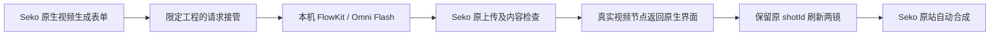

# Seko 原生生成接入 Flow：任务与验收

日期：2026-10-13。本轮授权：继续使用 REA，接管 Seko 生成，用自己的 Flow 生成、回填、原站出片并展示真实结果。

## 方案

分析已登录站点当前构建中的生成请求、上传与镜头刷新逻辑。仅在指定测试工程启用明确的 Flow 接管，不调用 Seko 原生生成模型。实际触发界面生成动作并留证；Flow 使用现有 Omni Flash 与参考图，完成后通过原站上传、写入镜头并原站渲染。任何未知状态停止并报告，不自动改用其他模型或重试付费生成。

## 任务卡

| 卡片 | 工作 | 验收标准 | 状态 |
|---|---|---|---|
| N01 | REA 分析生成/上传的相关模块并核对页面 | 记录真实导出、调用参数、作用范围 | 通过 |
| N02 | 实现限定工程的生成接管与任务状态 | 原生界面动作进入 Flow，原站生成请求不提交 | 通过，两次原生按钮触发 |
| N03 | Flow 真实生成与自动上传回填 | 新媒体 ID、文件哈希、原镜头 ID、持久化结果 | 通过，两段不同新视频 |
| N04 | Seko 原站合成、下载并检查 | 新成片可播放、时长/画面/音轨实测 | 通过，16.041667 秒 |
| N05 | 测试、验收、记录、提交 | 明确已完成和限制，展示视频及页面截图 | 16 项新增测试、24 项实物审计通过；随本记录提交 |

不会以旧的 16 秒拼接结果充当本轮生成接管证明。整集 3–5 分钟、固定音色、精确台词与口型不在此次短链路验收范围内。

## 本轮链路与实测结果



1. REA 6.4.0 分析 `canvas-BZat8bJg.js`、`shot-BflClSjB.js`、`useOSSUploader-BaPQIV7u.js` 三个已取得的官方模块，解析失败 0，198 条 findings。生成导出追踪命中 2 个种子，172 节点、204 边。完整覆盖仅指三文件输入范围，不是整个网站。
2. 人工核对调用关系：原生首帧视频生成使用 `canvas.c → LoginContext.g.post → seko-canvas/v1/canvas-node/gen-video`。参数含 `firstFrameNodeId`、`videoPrompt`、`processedPrompt`、`selectedVideoDuration`、`resolutionType`、`visionRatioId`、`canvasId`。
3. 在测试画布 `2110113293747896321` 临时包装该请求方法，两次真实触发表单提交动作。捕获之后原请求保持等待，直到实际 Flow 视频上传成为真实 Seko 节点，才用原站节点回执恢复界面。没有伪造服务器生成完成状态。
4. 原生表单保留其原模型名 `Seedance 1.0 Pro Fast`；页面醒目标识明确显示实际后端为 Flow Omni Flash。该模型选择仅用于原站表单设置，两个生成请求都在发送前改道，未调用该原站模型。
5. 两次捕获的原始提示词逐字用于 Flow；均使用同一已验证 Nano 参考图，8 秒、16:9、720p。第一段黄色纸船漂过石桥，第二段白鹭走上石桥，两份新媒体和哈希不同。
6. 完全自动调用原站上传方法，保留原站内容检查且两段均通过；无需系统文件选择器。以实际上传路径创建 VIDEO 节点，再对既有镜头显式 REPLACE；第二次回填的完成 Promise 自动触发 Seko 原站渲染。
7. 记录的两段网络观察窗口均标记未截断，观察到的 `gen-video` / `multi-ref-video` 原站 HTTP 请求数均为 0；第二段还保存了 `hasMore: false`，第一段快照未保存该字段。结合请求包装记录和测试，确认本次两个被捕获的原生请求未发送到原站生成服务。页面显示的 Seko 积分测试前后均为 110。Flow 实际提交两次，未自动重试生成。
8. 出片后解除临时请求包装并重新打开编辑器。镜头引用仍为新素材，编号/顺序/时长/裁剪/音频开关保持一致；页面已无接管脚本。

| 项目 | 第一段 | 第二段 |
|---|---|---|
| 本机接管任务 | e2ef74e7-0d01-49ae-8669-ef8d790a2d5d | fc1a47e4-58b1-4e25-9949-2f66844eac9d |
| Flow 请求 | 7da7f0a9-67cc-4524-bec2-315d628ae330 | aac9efe0-79b6-4bf4-a1eb-bcdbfb8855d4 |
| Flow 媒体 | 74b7cac7-f960-43ab-bfe8-062623657aea | 06c1a4de-5bc4-4d15-9d13-ec5945b51a71 |
| Seko 新视频节点 | 2110197761211367425 | 2110198754356355073 |
| 保留的原镜头 ID | 2110113965192040450 | 2110114181198118913 |
| 成片与源片中央区域 SSIM，偏移一帧 | 0.987288 | 0.990907 |

Seko 原站渲染任务：`2110198756638892033`，状态 `GENERATING_COMPLETED`。成片为 1280×720 H.264/AAC，16.041667 秒。两个原片各 192 帧，成片 385 帧，仍多一帧；不能据此通过精确口型验收。两份素材从 Seko 回下载后 SHA-256 均与 Flow 原文件完全一致。

## 可复用代码与操作

- `scripts/seko_generation_hook.js`：临时安装到当前授权页面，限定画布、参考图和 8 秒任务；重复任务、其他已识别生成路由及不支持的输入明确拒绝。`dispose()` 恢复原方法，未完成任务时拒绝解除。
- `scripts/seko_flow_job.py`：`submit` 接收捕获快照并通过 Flow 批量 API 创建唯一任务；`collect` 单次查询、下载、验证。文件独占锁和状态记录防止未知提交结果造成重复消费。
- `scripts/seko_native_backfill.js`：核验传输哈希，调用原站上传、内容检查、真实节点创建及镜头刷新；`sekoNativeRender` 校验两镜均为新素材后提交带原水印的原站合成。
- 当前浏览器桥接由 CUA 会话调用上述代码；本轮临时内存包装已解除，刷新不会自动接管。尚未交付常驻服务、自动重连、任意剧本调度或整集无人值守工作台。

执行时首先核对当前构建的模块名、测试工程和参考图映射。通过授权 CUA 页面安装请求包装，实际提交表单，保存 `snapshot()`。Flow 调度示例：

```sh
python3 scripts/seko_flow_job.py submit --capture '<捕获快照>' --job-id '<捕获 jobId>' --flow-project '<Flow project UUID>' --reference-scene '<已完成参考图的 scene UUID>' --state '<新状态文件>'
python3 scripts/seko_flow_job.py collect --state '<同一状态文件>'
```

下载完成后，CUA 每次传入最多 49,152 字节，页面重组文件并校验 SHA-256，再调用 `sekoNativeBackfill`。两镜完成后调用 `sekoNativeRender`。原站 Cookie、上传临时凭证保留在页面，未导出到本机脚本。

## 故障及优化记录

- 最初尝试把约 1.2 MB 参考图一次编码传入调试通道时，浏览器连接中断。未取得上传回执，不计成功；恢复同一 Chrome 配置的新调试页后，采用 49,152 字节分块传输，上传及检查成功。此次没有修改浏览器安全设置。
- 画布节点可能被工具栏或侧栏遮挡；普通定位点击曾只聚焦标题，没有执行生成。改用已观察到的精确元素执行其原生点击事件，并检查真实请求捕获，不能以“点击已执行”代替成功。
- Seko 原有视频导入镜头的编辑器生成模式不可直接使用，故本轮选择原生画布空白节点的首帧生成表单。结果仍回填原编辑器的两个镜头。
- 原生服务响应依赖节点 ID，而非必须依赖原站付费生成任务 ID，因此可返回已完成上传的真实节点回执。节点来源保留 USER_UPLOAD，未假冒原站模型生成来源。

## 验收产物

- 成片：`output/seko-native-flow-20261013/seko-native-flow-16s.mp4`。
- 界面截图：`output/seko-native-flow-20261013/seko-final-editor.png`。
- [24 项实物审计](benchmarks/seko-native-flow-20261013/audit.json)、[REA 摘要](benchmarks/seko-native-flow-20261013/rea-summary.json)及同目录脱敏快照。
- 测试：生成请求拦截 6 项，Flow 捕获合同 4 项，自动回填保护 6 项，共 16 项通过。覆盖原生请求不外发、错误工程/引用/时长拒绝、重复提交保护、哈希错误、审核拒绝和旧时间线引用等失败情形。

这是两段新风景素材的接入样片，尚未制作《雨停之前》的六镜对白，也未验收固定音色、精确台词或 3–5 分钟整集。
