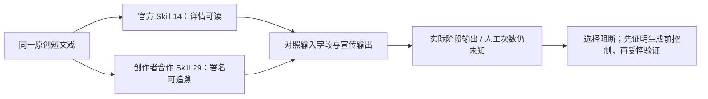
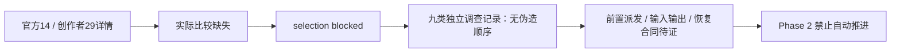

# Seko 工作流候选与接管边界

审计日期：2026-10-15。**双方真实来源和同稿元数据对照已完成；实际执行比较未完成，selection=blocked，comparison_complete=false，feasibility=unassessed。** Seko 原站与 Skill 仍是主线。未运行候选、未调用使用/生成/上传入口，不能据文案选择“完整且最少人工”的流程。

## 来源与比较范围

来源入口：[原站技能社区](https://seko.sensetime.com/skill-community)，打开对应卡片的详情。可复核的读取路由为 `GET /guodong-api/guodong-studio/v1/skills/14` 与 `/29`，本轮详情请求200。登录保留在浏览器。结构化候选、来源摘要和哈希见 [evidence.json](benchmarks/workflow-boundaries/evidence.json)。

| candidate_id | 候选 / 来源 | 实际读到的身份与证据 |
| --- | --- | --- |
| `official-14` | BJD古偶甜宠剧；official | 原站官方详情与作者栏，`ev-skill-official-14`；历史metadata也记录Seko官方，但历史模型偏好单列 |
| `creator-29` | 复古梦核情绪短片【你翔哥哥】；community | 详情明确介绍签约创作者“你翔哥哥”，Skill名称同人署名，官方合作发布；`ev-skill-creator-29`。发布者Seko官方与创作者分开，不要求创作者独立于厂家 |

29 的作者来源还附[公开社媒定位](https://www.xiaohongshu.com/user/profile/5b3a40386b58b7598a17a947)。去掉查询参数打开时跳到外站登录，未登录或导出参数；原站明确署名足以作为创作者合作候选来源，未额外认证社媒账号。页面源码在 userProfile 未提供时会显示“官方作者”默认文案，因此不能仅凭发布栏把所有创作者合作项都排除，也不能把冠名当成完整执行证据。

已检查范围：原工程Skill面板、主页技能社区、官方精选可见20项、成片工作流可见16项、详情14/23/29。23「幽默反讽家庭剧【阿松的奋斗】」有创作者介绍，作为发现记录保留；本轮深入比较固定14和29，没有无限扩展候选。目录数量是可见范围，不宣称网站全量清单。`ev-skill-search-scope`。

## 同一完整输入

ID：`original-dialogue-station-v1`；UTF-8 SHA-256：`e12ba3f620b89f1fc50ff01d0900b56d990bb1baaa9ab25e558ba0afb9d4a5bc`。

> 原创短文戏《最后一班车》：雨后的车站，两位成年朋友林夏和陈舟站在屋檐下。林夏拿着一封没寄出的信，问：“你明天还会回来吗？”陈舟把车票收进口袋，说：“如果你愿意等，我就回来。”广播提醒末班车即将进站。林夏把信递给他：“那就带着它，别再把话留到以后。”陈舟接过信，点头，两人安静地望向路口。只提供这个故事梗概，不预先补全分镜、画风或声音配置。

此稿仅供同条件字段及流程对照，未提交网站；不规定产品输入格式或画风，也不假设用户已备完整台词/分镜。没有为其中一条额外写提示词或补男女主偏好以缩短人工成本。

## 流程覆盖与人工操作

下表“声称”均来自宣传详情，**实际阶段输出均未运行观察**。读到介绍属于 observed access，不属于 observed output。

| 核对列 | 官方14 | 创作者合作29 |
| --- | --- | --- |
| 同稿需要补充的字段 | 要求男女主、偏爱原因、甜度等；同稿未给后两者 | 接受主题、意象、人物或剧情灵感；同稿可作为剧情灵感，实际消费方式未知 |
| 编剧与拆镜 | 声称大纲、分集规划、单集剧本、分镜表 | 声称完整剧本、结构化大纲、分镜故事板 |
| 图片与视频 | 声称提示词及视频素材、多图参考一致性 | 声称角色/场景/道具资产图、视频片段、多资产参考 |
| 声音与口型 | 详情未明确，未知 | 声称旁白及音色参考、双语旁白音色库；精确对白/正面口型未知 |
| 合成 | 视频素材到最终成片衔接未知 | 声称180秒内成片闭环；实际合成任务与成片未知 |
| 阶段确认次数 | null；文案明确逐步确认大纲/脚本/视觉资产，不能由三类名称推算三次 | null；详情未列阶段确认次数，不能记0 |
| 编辑次数 | null，未观察 | null，未观察 |
| 素材搬运次数 | null，未观察 | null，未观察 |
| 质量与可控性 | 未运行同稿；用户目标画风开放 | 未运行同稿；复古梦核风格仅候选特性，不锁定产品画风 |

`source_evidence_ids` 分别为 `ev-skill-official-14` / `ev-skill-creator-29`；所有人工项保持 null，输出全部 advertised。29 宣传覆盖较广，14 阶段确认更明确；这些仅形成下一次验证重点，不足以决定谁流程更完整、人工更少。

## 实际入口与当前阻断

当前页面资源 `skill-community-B7782ZfW.js` 的只读对照（`ev-skill-use-contract`，SHA-256 `9100921a…`）确认：列表/详情为GET；“使用”路径有 `PUT /v1/skills/{id}/use`，并生成带 `canvasId/text/skills/ref_skill_ids/attachments/referencedNodeIds` 的 Agent handoff。选择/进入画布可能自动启动后续Agent。静态发现尚未证明厂家图视频派发发生在哪里，也未证明可在派发前暂停并接收自有Flow结果。

本轮未调用 use、生成或写素材。网络记录只用于已见详情状态；事件窗口曾truncated，不宣称全窗口“生成请求0”审计。既有桥只定向转交画布首帧视频，而且当前新标签启动失败，见 [构建兼容矩阵](SEKO-BUILD-COMPATIBILITY.md)。不应盲跑Skill来补齐人工次数，更不能失败后改回厂家图片/视频。

selection 的具体阻断为：双方缺真实执行输出与人工计数；当前桥构建失配；Skill生成前暂停/替换契约未证明。BASE-02保持pending。技术可行性尚未评定，不把缺证据写成“技术不可能”。下一卡可继续整理真实步骤合同与模型证据，但不能伪造选定流程或完整接管结论。

## 已采集模型与服务事实（供01-03路由表使用）

| 来源 / 级别 | 实际记录 | 不可推导的结论 |
| --- | --- | --- |
| 本轮本机 GET `/api/models` + models.json，`ev-model-flow-catalog` | default_image_model=`NANO_BANANA_2_1`；映射到`BELUGA`；flow_batch别名字典同样对应 | 这是配置，非本轮真实生成请求或已接管Seko图片证明 |
| 同上 Omni 配置 | frame_to_video：4/6/8/10秒对应`abra_i2v_4s/6s/8s/10s`；reference_to_video对应`abra_r2v_4s/6s/8s/10s` | 用户“Omni”不能忽略模式/时长；8秒首帧对应`abra_i2v_8s`只表示配置事实 |
| 官方14历史metadata，`ev-model-seko-metadata` | 2026-10-14 `preferModel=gmlm-3-flash`；本轮页面显示GMLM 3 Flash | 偏好与界面显示不是图/视频实际模型，也不能套到29 |
| 本轮首页展示 | Seedance全能模式、Seedance2.5视频生成等标签 | 展示目录不等于两个候选实际请求；不填作候选真实model key |

未修改任何模型配置。厂家编剧/拆镜、配音、口型、剪辑按用户分工保留；具体未暴露型号在01-03仍应未知，不能猜。历史MINIMAX音色及SekoTalk实验见既有对白报告，不能迁移为当前Skill实际调用证明。

## 逐步合同：未选定时的独立事实

`selection=blocked`，因此没有“选中流程”的步骤序列。`steps` 的九个 `investigate-*` 记录均 `required=false`、`executor=unknown`、`depends_on=[]`，用于定位官方14待证类别；29的对照仍在 candidates 与 model_routes。类别清单来自本次调查范围，不是声称厂家按九步运行。实际 inputs/outputs 原字段、状态、失败语义和人工次数全部保留 unknown/null；不能把历史实验拼成候选运行。

| step_id | 已知的独立事实 | 候选当前合同缺口 |
| --- | --- | --- |
| investigate-writing | 14历史preferModel与当前页面模型显示；`ev-model-seko-metadata`、`ev-boundary-visible-ui` | 实际编剧请求、输出及执行层未知 |
| investigate-storyboard | 14/29宣传分镜输出；`ev-skill-official-14`、`ev-skill-creator-29` | 真实拆镜顺序、确认次数未知 |
| investigate-image | 本机图片目录可读；`ev-model-flow-catalog` | 候选厂家图片实际请求/派发控制未知 |
| investigate-video | 本地桥只匹配画布`seko-canvas/v1/canvas-node/gen-video`；`ev-seko-canvas-current` | 编辑器`guodong-studio/v1/shots/{id}/gen-video`与Agent `drama-script/plan`、`next-ep`为不同入口；实际候选派发未知 |
| investigate-voice | 历史TTS精确文本和音色ID存在；`ev-boundary-dialogue` | 当前候选服务/型号/语音输出未知 |
| investigate-lipsync | 历史SekoTalk首帧重生成；同上 | 当前候选是否调用、是否保留Flow动作未知 |
| investigate-edit | 历史时间线编排成功；同上 | 当前候选素材引用、编辑/搬运次数未知 |
| investigate-export | 历史合成状态`GENERATING_COMPLETED`；同上 | 当前候选成片和状态流未知 |
| investigate-review | 本地质检角色配置可读；`ev-boundary-review-config` | 候选原生质检是否存在/实际模型未知 |

本机桥的已读静态输入包括 canvasId、firstFrameNodeId、selectedVideoDuration=8、visionRatioId=1、resolutionType=1、videoPrompt/processedPrompt；参考图必须已有显式Flow映射。输出验证为node.genStatus=`GENERATING_COMPLETED`和上传路径匹配，本机状态有submitted/ready/uploaded/complete及needs-inspection。以上为已有画布适配代码合同，**没有填进候选的实际输入输出**。来源：`extension/seko_page.js`、`agent/api/seko.py`；独立编辑器与Agent发现见`ev-seko-editor-discovery`/`ev-seko-agent-skill`。

## 任务到模型路由（当前事实与目标分开）

每行关联`model_routes.step_id → steps.id → evidence_ids`。**当前候选的实际生成请求均未观察；目标Flow映射尚未全面生效。** 模型不可见统一记unknown，不选替代模型。

| 任务 / step_id后缀 | 当前提供方与精确key | 用户目标提供方 / key | 参数与证据等级 |
| --- | --- | --- | --- |
| 编剧 writing | Seko编排；实际key未知。仅官方14历史偏好`gmlm-3-flash`；当前页面显示GMLM 3 Flash | 保留Seko；实际key待核验 | `ev-model-seko-metadata`/`ev-boundary-visible-ui`；metadata/UI，不是实际调用 |
| 拆镜 storyboard | Seko候选实际key未知，不套用编排偏好 | 保留Seko；key待核验 | 14/29详情advertised；`ev-skill-official-14`/`ev-skill-creator-29` |
| 图片 image | Seko候选实际key未知 | 自有Flow；`NANO_BANANA_2_1 → BELUGA`（用户Nano Banana 2.1） | `ev-model-flow-catalog`；GET `/api/models`+models.json+flow_batch别名，仅配置 |
| 视频 video | Seko候选实际key未知；既有桥仅映射画布首帧 | 自有Flow Omni；`abra_i2v_8s` | 8s、720p、横屏、frame_to_video；`ev-model-flow-catalog`/`ev-seko-canvas-current`。模式/时长不同需显式匹配，不能自动换型号 |
| TTS voice | 历史MINIMAX服务；精确模型未暴露 | 保留Seko；key待核验 | `ev-boundary-dialogue`；42/30是toneId，speedRatio=1，非模型型号 |
| 口型 lipsync | 历史SekoTalk；精确模型未暴露 | 保留Seko；key待核验 | 服务选择码`sensetime`、resolutionType=1、SINGLE；历史首帧重生成，不保留Flow动作 |
| 剪辑 edit | 历史Seko时间线；未暴露模型 | 保留Seko | `ev-boundary-dialogue`；候选当前操作未知 |
| 导出 export | 历史Seko合成服务；未暴露模型 | 保留Seko | 历史captionOption=1/splitOption=0/watermarkOption=1；合成不是图视频生成模型 |
| 质检 review | 本地video_review配置provider=`claude`、model=null、effort=null；Seko原生未知 | 自动质量检查责任与实际型号待Phase2落实 | `ev-boundary-review-config`；null只说明CLI默认未解析，本轮未调用外部模型 |

开发代理：GSD `model_profile=inherit`、`resolve_model_ids=omit`，gsd-executor继承当前会话、effort=high；resolver没有返回具体模型ID，不猜型号。本轮没有外部cross-AI执行。开发代理模型、Seko编排LLM、图视频生成模型和质检角色是四个不同层级。

## 生成前控制与保留服务：01-03-02

| 边界 | 当前结论 | 已核对证据 | 仍缺的具体证明 |
| --- | --- | --- | --- |
| 画布首帧视频 | 当前候选unproven | `ev-seko-canvas-current`定向post转交；`ev-build-page`新标签失败；三个旧依赖404 | 当前构建执行层匹配、厂家任务未创建、真实输入/结果/恢复三合同 |
| 编辑器图片/视频 | unproven | `ev-seko-editor-discovery`独立shots路由；本地桥没有对应转交 | 真正派发层、外部产物注入与恢复；不能把fetch拒绝当Flow接管 |
| Agent/Skill | unproven | `ev-skill-use-contract`使用会handoff，历史Agent事件入口可见 | 服务端派发前暂停/外部执行/继续协议；事后事件不是前置控制 |
| 保留编剧/拆镜/声音/口型/剪辑/导出 | 当前实际executor仍unknown；用户目标保留厂家 | 候选宣传与历史对白分开引用 | 当次实际服务/媒体变化；未替换不自动判技术不可能 |
| 全局视频保护对保留服务影响 | unknown | `extension/seko_page.js:30`匹配gen-video/multi-ref-video/regenerate/video-retake | 当前口型/剪辑的实际调用路径及命中记录；没有当次误伤证据 |

本次所有调查项control为unproven、dispatch_observation=unknown。没有以浏览器无请求声称服务器未建任务。既有桥在原生请求发生前可拒绝特定fetch只是源码事实；既有旧页面“5完成/1待检查”是历史任务显示。当前新页面桥失败是真实局部阻断，尚不足以证明整个Seko工作流技术不可接管。

保留服务的`retained_media`单独记录actual status=unknown。历史SekoTalk事实：从Flow视频首帧与精确音频生成新口型视频，最终来源为Flow画面+Seko配音口型重生成，不能声称Flow动作保留。`lipSyncModel=sensetime`是历史服务选择码，未暴露底层模型精确key。当前候选是否使用相同路径仍待证。

已尝试范围限定为原站现有工程UI、当次构建/详情只读样本、本地桥与历史踪迹。没有点击Skill使用/生成、写入时间线、移除保护或修复生产桥。下一步证据应为明确可挂起的执行层协议或真实已有任务踪迹，包含厂家任务是否建立、外部输入输出、恢复身份；不能以更多静态路由补齐运行证明。

## 后续接入清单与推进门槛：01-03-03

清单是基于调查项的责任交接，尚不是已选工作流的可执行映射。`integration_items`有19项，均关联存在的step_id；依赖为调查→适配→回填，不冒充厂家实际执行顺序。

| 接入项 | 归属 | 输入 → 输出 | 验收与当前阻断 |
| --- | --- | --- | --- |
| int-writing/storyboard/image/video/voice/lipsync/edit/export/review | Phase1 | 真实协议/观察 → 候选逐步合同 | 实际执行/控制未证，保持pending |
| adapt-image / adapt-video | Phase2 | 源请求、参考映射、转换参数 → Flow任务与新媒体 | 前置控制成立后实施；精确key/输入输出审计；图片BELUGA、8秒首帧abra_i2v_8s需实际请求证明 |
| backfill-image / backfill-video | Phase3 | Flow媒体、状态与步骤身份 → 原站素材/镜头/时间线/继续状态 | 验证新引用，防止节点变而旧镜头未变；不能旧素材补齐 |
| retain-writing/storyboard/edit/export | Phase3 | 原站真实输入 → 厂家输出 | 保留厂家分工；导出须全镜合格；候选真实合同仍未知 |
| retain-voice / retain-lipsync | Phase5 | 文本/音色/音频/图像 → 声音与口型视频 | 精确对白、固定声音和口型独立验收；披露最终媒体来源 |

固定后续规则：首次生成之外最多 **2次同模型质量重做**，仍不合格暂停并解释；未知提交先核对，不能当质量失败重发。失败镜头及依赖暂停，独立镜头继续；全部镜头合格才输出最终片。质量重做归Phase2，依赖调度/恢复归Phase3/4，Phase6整体验收。本阶段只交接，不实现调度。没有失败后改提供方、改模型或伪造成功的路径。

| 机器输出 | 本次值 | 含义 |
| --- | --- | --- |
| contract_valid | true | 证据引用、哈希、结构与结论一致 |
| report_complete | false | 同稿实际比较、完整步骤和当前控制证据仍缺 |
| feasibility | unassessed | 尚不能判可行，也不能判完整工作流技术不可能 |
| ready_for_phase2 | false | 依赖阶段不得自动推进 |

BASE-01、BASE-03已有来源复核记录；BASE-02、BASE-04保持pending。阶段边界报告验收未通过，M1/整集均未验收。若后续取得充分技术阻断证据，才进入带证据的范围决定；当前不把缺证据问题交给用户代选底层技术。真实产品范围问题遵循D-12，一次一道可点击题并接受自由说明。

## 验收

62项检查器单测通过；覆盖历史/当前、步骤依赖、派发时机、执行层证明、技术阻断与缺访问区别、模型来源和质量交接规则。实际final返回contract_valid=true、report_complete=false、comparison_complete=false、feasibility=unassessed、ready_for_phase2=false。合同有效只说明诚实记录了比较缺口。

`python3 scripts/workflow_evidence_probe.py --evidence docs/benchmarks/workflow-boundaries/evidence.json --build docs/benchmarks/workflow-boundaries/current-build.json --stage final`

来源与文字语义由执行器复核；未代替用户本人验收。候选选择与完整执行仍未通过。后续不能将本报告的blocked记录转写为已选中、已验证最少人工或阶段整体完成。
